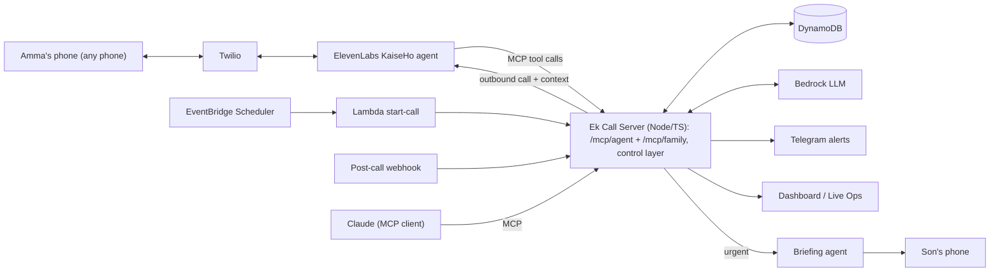

# KaiseHo, powered by Ek Call

**wHACKiest 2026 · Track 01: Make MCP Matter · Team SantaClaude (M S Ramaiah Institute of Technology) · Team ID 6e091a28**

> *"One call a day. Peace of mind for the whole family."*

KaiseHo makes a short (2–3 minute), consented AI check-in call to elderly parents every day, in their own language (Kannada / Hindi / English), on any phone, including keypad phones. It checks on medicines, mood and health, remembers what matters, catches scam calls, escalates emergencies, and tells the children (who live in other cities) **when to call and what to ask**.

It runs on **Ek Call**, a phone-native MCP agent engine: **one MCP server, two doors.**
- `/mcp/agent`: the ElevenLabs voice agent calling Amma uses it during the call.
- `/mcp/family`: the child asks Claude *"How was Amma this week?"* through the same server.

Safety rules (risk tiers, PII redaction, audit) are enforced **in the server, not in the prompt**. No tool can touch money, OTPs or IDs.

## Pitch deck
- [`docs/pitch/KaiseHo_SantaClaude_wHACKiest2026.pptx`](docs/pitch/KaiseHo_SantaClaude_wHACKiest2026.pptx): the official template, filled in, with 2 extra slides (Prototype Showcase, Control & Evaluation)
- `docs/pitch/mockups/`: HTML prototype screens (Live Ops, Telegram alert, Claude via MCP, family dashboard); `docs/pitch/screens/` has them as PNGs

## Architecture

## Plan
[`plan.md`](plan.md) is the single source of truth: features (P0–P3), MCP tool specs, data model, build phases, demo script.

## Build status
- [x] Pitch deck (ideation round)
- [ ] Phase 0: Submission MVP (monorepo, MemoryRepo, `/mcp/agent` 5 tools, scam rules, live feed dashboard)
- [ ] Phase 1: Real calls + post-call brain
- [ ] Phase 2: Family MCP door + dashboard
- [ ] Phase 3: Emergency cascade, briefing agent, Live Ops, digest
- [ ] Phase 4: AWS hardening

## Team SantaClaude
| Member | USN |
|---|---|
| Shourya Chouhan (Lead) | 1MS25CS185 |
| Shreya Singh Chouhan | 1MS25CS187 |
| Daksh Bhatt | 1MS25CI037 |
| Devansh Jain | 1MS25CS050 |

