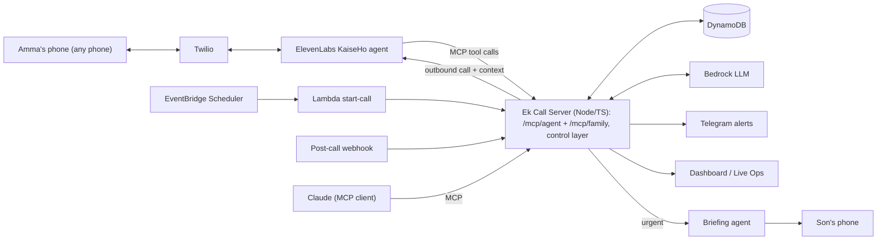

# KaiseHo, powered by Ek Call

**wHACKiest 2026 · Track 01: Make MCP Matter · Team SantaClaude (M S Ramaiah Institute of Technology) · Team ID 6e091a28**

> *"One call a day. Peace of mind for the whole family."*

KaiseHo makes a short (2–3 minute), consented AI check-in call to elderly parents every day, in their own language (Kannada / Hindi / English), on any phone, including keypad phones. It checks on medicines, mood and health, remembers what matters, catches scam calls, escalates emergencies, and tells the children (who live in other cities) **when to call and what to ask**.

It runs on **Ek Call**, a phone-native MCP agent engine: **one MCP server, two doors.**
- `/mcp/agent`: the ElevenLabs voice agent calling Amma uses it during the call.
- `/mcp/family`: the child asks Claude *"How was Amma this week?"* through the same server.

Safety rules (risk tiers, PII redaction, audit) are enforced **in the server, not in the prompt**. No tool can touch money, OTPs or IDs.

## Pitch deck
- [`docs/pitch/KaiseHo_SantaClaude_wHACKiest2026.pptx`](docs/pitch/KaiseHo_SantaClaude_wHACKiest2026.pptx): the official template, filled in, with 2 extra slides (Prototype Showcase, Control & Evaluation)
- `docs/pitch/mockups/`: HTML prototype screens (Live Ops, Telegram alert, Claude via MCP, family dashboard); `docs/pitch/screens/` has them as PNGs

## Architecture


## Run it (2 minutes)
Needs Node 20+ and pnpm.
```bash
pnpm i
cp apps/server/.env.example apps/server/.env          # optional: add Telegram / ElevenLabs keys
cp apps/dashboard/.env.example apps/dashboard/.env.local
pnpm dev                 # server :8787 (seeds Lakshmi Amma's demo family) + dashboard :3000
pnpm simulate            # plays a scripted check-in call through the real MCP endpoint
```
Open http://localhost:3000 to watch tool calls, the scam check and alerts arrive live.
Without a `.env`, the dev tokens are `dev-agent-token`, `dev-family-token` and `dev-internal-token`. If you set your own `FAMILY_TOKEN_DEMO`, put the same value in the dashboard's `NEXT_PUBLIC_FAMILY_TOKEN`.

**Talk to it for real (ElevenLabs browser call):** `pnpm tunnel`, then follow [`agent/kaiseho-caller.config.md`](agent/kaiseho-caller.config.md). It covers the prompt, the MCP server URL and token, and the dynamic-variable defaults.

**Telegram alerts:** create a bot with @BotFather, set `TELEGRAM_BOT_TOKEN`, and set `TELEGRAM_DEMO_CHAT_ID` to your chat id. Scam alerts and Amma's messages then reach your phone.

| Command | What it does |
|---|---|
| `pnpm test` | Unit tests: PII redaction (en/hi/kn), scam rules, risk-tier enforcement, privacy filtering |
| `pnpm eval:scam` | Scam Shield eval on 40 cases (20 scams across 9 patterns in 3 languages + 20 legit look-alikes) |
| `pnpm seed` | Re-seed the demo family on a running server |
| `pnpm ask-family` | Ask the family MCP door the demo questions (weekly summary, starters, add medicine, message) |
| `pnpm tunnel` | Public HTTPS URL for ElevenLabs (cloudflared) |
| `pnpm setup:elevenlabs` | Creates/updates both agents, MCP servers, webhook, phone assignment |
| `pnpm setup:twilio` | Number, India geo-permissions, caller-ID verification, ElevenLabs import |
| `pnpm --filter @kaiseho/infra run deploy` | AWS stack (ap-south-1). Then `secrets:push` |

### What's in the box
**Landing page** (http://localhost:3000): the story of KaiseHo with scroll-driven animation, including a live call on a phone, a pinned "how it works" walkthrough, a live Scam Shield meter, the MCP "two doors" diagram and a features bento. Midnight Marigold design language, light and dark.

**Family app** (http://localhost:3000/app), a multi-page app with a sidebar, a parent switcher, a ⌘K command palette and an alerts drawer:
- **Overview:** her day in one sentence, wellbeing index, today's tiles (mood, sleep, medicines, next call), latest check-in, conversation starters, AI insight cards, the household list, the latest story and the mind gym.
- **Wellbeing:** six-dimension constellation, 30-day index river, patterns, voice vitality, mind gym trends.
- **Health:** home readings, medicines, adherence, refills, appointments, prescription photo, emergency health card QR, doctor brief.
- **Calls:** call style (clear assistant or warm companion), schedule and away mode, every check-in with redacted transcripts, weekly audio digest.
- **Family:** shared household list board, messages, call rota, grandchildren's voice notes, "what she hears", family circle with Telegram link codes.
- **Story book** (Yaadein): her life stories as chapters, ask her a question, waiting questions.
- **Life admin:** reminder calls, occasions and festivals, pension life certificate.
- **Alerts & safety, Privacy & trust, Audit log, Connect Claude.**
- **Live Ops** (`/live`): a projector view. Shows the live conversation interleaved with MCP tool calls colour-coded by risk tier, alert fan-out, and demo controls.

**Telegram bot:** a clean card after every call. One-tap buttons update every sibling's copy ("✅ Ravi is on it"). Commands: `/today`, `/tell`, `/needs`, `/meds`, `/call`, `/remind tomorrow 9am eye drops`, `/story`, `/stories`, `/away`, `/digest`. Plain text and voice notes become messages for her next call.

**Server:**
- **`/mcp/agent`** (voice agent, 23 tools, incl. `log_vital`, `add_need`, `save_life_story`, `log_brain_game`): `log_medication`, `log_wellbeing`, `save_memory`, `check_scam`, `send_family_message`, `get_today_context`, `recall_memory`, `mark_message_delivered`, `set_reminder`, `request_callback`, `update_call_preferences`, `record_consent`, `raise_emergency`, `log_scam_drill`, `request_appointment`, `get_shared_with_family`, `keep_private`, `log_life_certificate`, `relay_wish`
- **`/mcp/family`** (Claude, 39 tools, incl. wellbeing + AI suggestions, readings, needs, call rota, health card, story book, mind gym, call style): weekly summary, trends, status, alerts + ack, conversation starters, audit log, call history, add/update/remove medication, leave a message, call now, set schedule, doctor brief, refills, book/get appointments, reminders (get/set/cancel), occasions (get/add), pension life certificate (status/mark), and "what she hears" (the read-back). Try it with `pnpm ask-family`.
- **Call engine:** a context builder pushes dynamic variables (meds, follow-ups, messages, last summary, live weather). Outbound calls go through ElevenLabs + Twilio, with a labelled *simulated* mode when no keys are set. There is also a no-answer ladder and a local scheduler for reminders, callbacks, retries and daily calls.
- **Post-call brain:** HMAC-verified webhook, then redacted transcript turns purged after 24 h, then the insight pass (LLM via `LLM_PROVIDER`, or deterministic rules), then memories, quality checks, flag alerts, and nudges + starters. When Amma mentions a family call, it counts toward the metric.
- **Safety:** risk tiers T0–T3 enforced in code. The emergency cascade alerts all family, places briefing calls to the son and the neighbour, and repeats until acknowledged. Scam Shield, PII redaction (en/hi/kn), and an audit of every call.
- **Weekly audio digest:** Sunday 8 PM. A warm 60-second script (LLM or rules) goes through ElevenLabs TTS to an MP3, then to Telegram audio and the dashboard player. Without a voice key, the dashboard reads it aloud in the browser.
- **Onboarding + consent first:** `/onboard` adds a parent with status `pending_consent`. Daily calls are blocked until the welcome call records a yes (`record_consent`), which also sets the sharing choices and the call time.
- **Scam Shield layer 2:** an LLM classifier with a 1.5 s hard timeout. The final score is max(rules, LLM), +0.1 when both agree; it falls back to rules automatically.
- **Telegram:** `/start <code>` linking and inline buttons (Acknowledge, Call Amma now, I called her). Set the webhook with `POST /internal/telegram/set-webhook`.

## Plan
[`plan.md`](plan.md) is the single source of truth: features (P0–P3), MCP tool specs, data model, build phases, demo script.

## Build status
- [x] Pitch deck (ideation round)
- [x] Phase 0: Submission MVP (monorepo, MemoryRepo, `/mcp/agent` 5 tools, control layer, scam rules, Telegram, live dashboard)
- [x] Phase 1: Call engine + post-call brain (live phone calls need ElevenLabs/Twilio keys)
- [x] Phase 2: Family MCP door + full dashboard redesign
- [x] Phase 3: emergency cascade + briefing agent, no-answer ladder, Live Ops, weekly audio digest, onboarding + consent call, Scam Shield LLM layer 2
- [x] Phase 4: AWS hardening: DynamoDB single table, EventBridge Scheduler → Lambda job runner, S3, Bedrock, Secrets Manager, EC2 + CloudFront, CloudWatch (see [docs/aws-runbook.md](docs/aws-runbook.md))
- [x] Phase 5 (P2 polish): refill prediction, change detection ("worth discussing with her doctor"), printable doctor brief, weekly scam "vaccine" drills (+ `get_doctor_brief` / `get_refills` for Claude)
- [x] Remaining P2 extras: "What did you tell Ravi?" read-back + "keep it private" (P2-13), pension life-certificate reminder with checklist (P2-9), occasions and relayed birthday wishes with a regional festival calendar (P2-10), family-visible reminder and callback calls (P2-11), multiple parents in different languages on one family (P2-12)
- [x] Final round, features: human-like calls (no rating questions; what she ate, who she met, whether she went out, one good moment), a 0-100 Wellbeing Index vs her own usual with explainable patterns (sleep → mood, company → mood, calls → next-day mood, pain trend, weekday misses, alone streaks, voice vitality) and Gemini suggestion cards; home readings by voice (sugar, BP, SpO2) against her targets with an emergency path; critical-dose follow-up calls; emergency health card (QR); shared household needs list with "I'll handle it" and LPG cylinder tracking; sibling call rota; grandchildren's voice notes (Gemini transcription)
- [x] Prescription photo → schedule (vision LLM + deterministic Indian Rx shorthand, family confirms every line, photo never stored) and the clinic-calling agent (third ElevenLabs agent, own `/mcp/clinic` door, books on the elder's consent, tells her in the next call)

## Team SantaClaude
| Member | USN |
|---|---|
| Shourya Chouhan (Lead) | 1MS25CS185 |
| Shreya Singh Chouhan | 1MS25CS187 |
| Daksh Bhatt | 1MS25CI037 |
| Devansh Jain | 1MS25CS050 |
