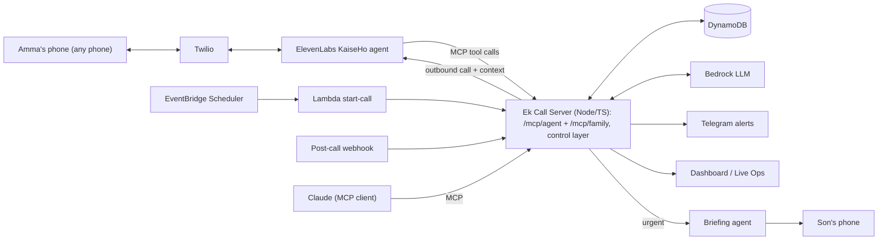

# KaiseHo, powered by Ek Call

**wHACKiest 2026 · Track 01: Make MCP Matter · Team SantaClaude (M S Ramaiah Institute of Technology) · Team ID 6e091a28**

> *"One call a day. Peace of mind for the whole family."*

KaiseHo makes a short (2–3 minute), consented AI check-in call to elderly parents every day, in their own language (Kannada / Hindi / English), on any phone, including keypad phones. It checks on medicines, mood and health, remembers what matters, catches scam calls, escalates emergencies, and tells the children (who live in other cities) **when to call and what to ask**.

It runs on **Ek Call**, a phone-native MCP agent engine: **one MCP server, two doors.**
- `/mcp/agent`: the ElevenLabs voice agent calling Amma uses it during the call.
- `/mcp/family`: the child asks Claude *"How was Amma this week?"* through the same server.

Safety rules (risk tiers, PII redaction, audit) are enforced **in the server, not in the prompt**. No tool can touch money, OTPs or IDs.

## Pitch deck
- [`docs/pitch/KaiseHo_SantaClaude_wHACKiest2026.pptx`](docs/pitch/KaiseHo_SantaClaude_wHACKiest2026.pptx): the official template, filled in, with 2 extra slides (Prototype Showcase, Control & Evaluation)
- `docs/pitch/mockups/`: HTML prototype screens (Live Ops, Telegram alert, Claude via MCP, family dashboard); `docs/pitch/screens/` has them as PNGs

## Architecture


## Run it (2 minutes)
Needs Node 20+ and pnpm.
```bash
pnpm i
cp apps/server/.env.example apps/server/.env          # optional: add Telegram / ElevenLabs keys
cp apps/dashboard/.env.example apps/dashboard/.env.local
pnpm dev                 # server :8787 (seeds Lakshmi Amma's demo family) + dashboard :3000
pnpm simulate            # plays a scripted check-in call through the real MCP endpoint
```
Open http://localhost:3000 to watch tool calls, the scam check and alerts arrive live.
Without a `.env`, the dev tokens are `dev-agent-token`, `dev-family-token` and `dev-internal-token`. If you set your own `FAMILY_TOKEN_DEMO`, put the same value in the dashboard's `NEXT_PUBLIC_FAMILY_TOKEN`.

**Talk to it for real (ElevenLabs browser call):** `pnpm tunnel`, then follow [`agent/kaiseho-caller.config.md`](agent/kaiseho-caller.config.md). It covers the prompt, the MCP server URL and token, and the dynamic-variable defaults.

**Telegram alerts:** create a bot with @BotFather, set `TELEGRAM_BOT_TOKEN`, and set `TELEGRAM_DEMO_CHAT_ID` to your chat id. Scam alerts and Amma's messages then reach your phone.

| Command | What it does |
|---|---|
| `pnpm test` | Unit tests: PII redaction (en/hi/kn), scam rules, risk-tier enforcement, privacy filtering |
| `pnpm eval:scam` | Scam Shield eval on 40 cases (20 scams across 9 patterns in 3 languages + 20 legit look-alikes) |
| `pnpm seed` | Re-seed the demo family on a running server |
| `pnpm tunnel` | Public HTTPS URL for ElevenLabs (cloudflared) |

### What's in the box (Phase 0)
- **`/mcp/agent`** (Streamable HTTP, bearer token): `log_medication`, `log_wellbeing`, `save_memory`, `check_scam`, `send_family_message`
- **Control layer:** risk tiers T0–T3 enforced in code (T2 needs the elder's consent and is rate-limited; T3 safety alerts override privacy). Every call is audited. `redactPII()` runs on everything stored (OTP, Aadhaar, PAN, card, bank account, IFSC) in English, Hindi and Kannada.
- **Scam Shield (rules layer):** 9 patterns with weighted keywords in 3 languages, plus authority/secrecy/urgency/money signals. It takes under 1 ms, and on a score of 0.6 or more it sends an urgent family alert.
- **Alerts:** dashboard + Telegram fan-out; acknowledge from the dashboard.
- **Dashboard:** today card (meds per slot, mood, sleep, pain, 14-day trend, follow-ups, private-item count) + live tool-call feed colour-coded by tier + alerts.
- **Privacy:** private memories never reach family views; no audio anywhere; data in memory (DynamoDB in `ap-south-1` in Phase 4).

## Plan
[`plan.md`](plan.md) is the single source of truth: features (P0–P3), MCP tool specs, data model, build phases, demo script.

## Build status
- [x] Pitch deck (ideation round)
- [x] Phase 0: Submission MVP (monorepo, MemoryRepo, `/mcp/agent` 5 tools, control layer, scam rules, Telegram, live dashboard)
- [ ] Phase 1: Real calls + post-call brain
- [ ] Phase 2: Family MCP door + dashboard
- [ ] Phase 3: Emergency cascade, briefing agent, Live Ops, digest
- [ ] Phase 4: AWS hardening

## Team SantaClaude
| Member | USN |
|---|---|
| Shourya Chouhan (Lead) | 1MS25CS185 |
| Shreya Singh Chouhan | 1MS25CS187 |
| Daksh Bhatt | 1MS25CI037 |
| Devansh Jain | 1MS25CS050 |

