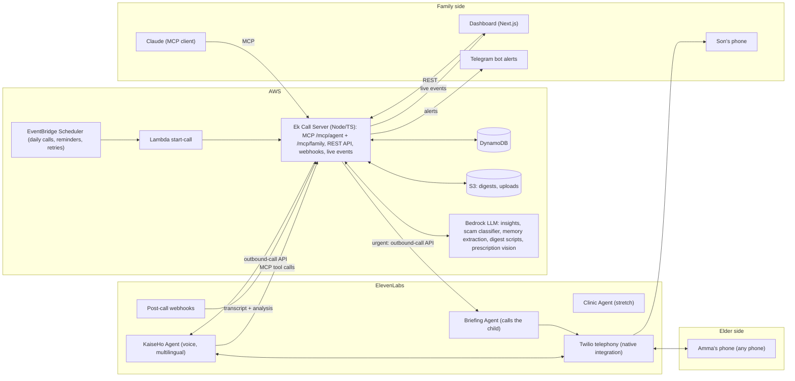
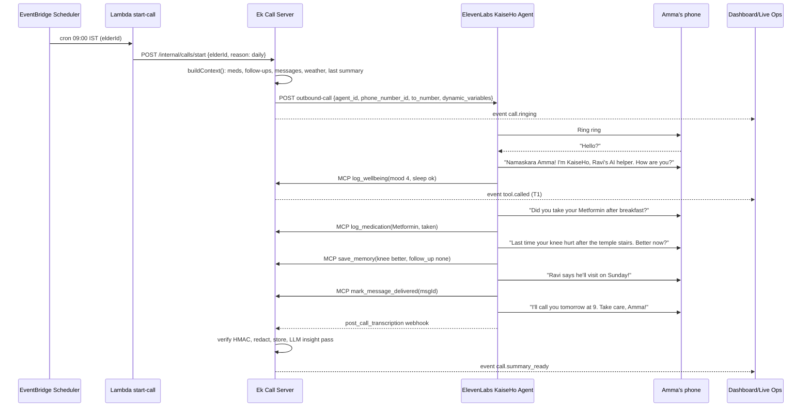
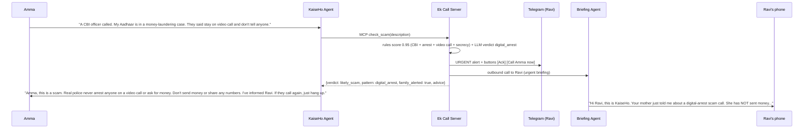
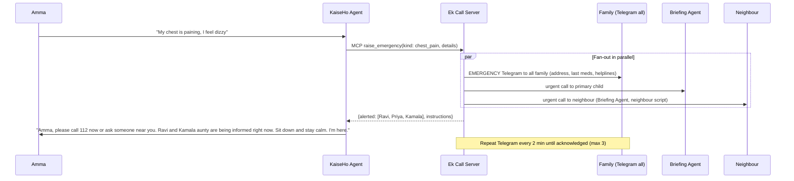

# KaiseHo — powered by Ek Call
### Master build plan · wHACKiest 2026 · Track 01: Make MCP Matter

> **"One call a day. Peace of mind for the whole family."**
>
> **KaiseHo doesn't call your parents instead of you. It makes sure you know when to call, what to ask, and when it's urgent.**
>
> KaiseHo is a short, practical AI check-in call for elderly parents, every day, in their own language, on any ordinary phone. It checks on medicines, mood and health, remembers what matters, protects them from scams, escalates emergencies, and keeps the children (who live in other cities) truly informed. It runs on **Ek Call**, a phone-native MCP agent engine. The parent needs no app, no internet and no smartphone. The child gets a dashboard, Telegram alerts, and can ask Claude *"How was Amma this week?"* through the same MCP server.

> **v2 changes (24 Nov, 20:35 IST):** reframed from "AI companion" to "a family check-in that makes the family call more" (Sections 1, 4, 5, 9); family nudges, conversation starters and a "family calls this week" metric are now **P0**; calls shortened to 2–3 minutes; privacy by design hardened (Section 6.5: no audio stored, transcripts deleted after processing, data kept in India, parent controls sharing); new Section 25 (cost and feasibility, including why we don't switch accounts) and Section 26 (tough judge questions with answers). Memory Book and "life stories" moved to the roadmap.

---

## Table of contents
0. [How to use this file (humans + coding assistants)](#0-how-to-use-this-file)
1. [The 30-second pitch](#1-the-30-second-pitch)
2. [The problem (with sourced numbers)](#2-the-problem)
3. [Users and what they need](#3-users-and-what-they-need)
4. [Product overview](#4-product-overview)
5. [Feature list: P0 → P3 with acceptance criteria](#5-feature-list)
6. [The control layer: safety, consent, privacy](#6-the-control-layer)
7. [System architecture](#7-system-architecture)
8. [Core flows (sequence diagrams)](#8-core-flows)
9. [ElevenLabs agent specs (prompts, variables, settings)](#9-elevenlabs-agent-specs)
10. [MCP server spec (every tool)](#10-mcp-server-spec)
11. [Data model](#11-data-model)
12. [Backend services and API routes](#12-backend-services-and-api-routes)
13. [Dashboard spec](#13-dashboard-spec)
14. [Intelligence layer (LLM prompts)](#14-intelligence-layer)
15. [Repo structure, stack, env vars, commands](#15-repo-structure-stack-env-vars-commands)
16. [AWS infrastructure](#16-aws-infrastructure)
17. [Build phases](#17-build-phases)
18. [Timeline and team roles](#18-timeline-and-team-roles)
19. [THE DEMO (the crazy one) + backup plan](#19-the-demo)
20. [Evaluation harness (numbers we show judges)](#20-evaluation-harness)
21. [Pitch: PPT content map + video script](#21-pitch-ppt-content-map--video-script)
22. [Risks and fallbacks](#22-risks-and-fallbacks)
23. [Roadmap: Ek Call as a platform](#23-roadmap-ek-call-as-a-platform)
24. [Docs and sources](#24-docs-and-sources)
25. [Cost and feasibility (free to build, honest to run)](#25-cost-and-feasibility)
26. [Tough judge questions (with answers)](#26-tough-judge-questions)

---

## 0. How to use this file

**For the team**
- This is the single source of truth. If the plan changes, change it here first, then the code.
- Sections 5, 10, 11 and 17 are the contract between team members. Do not rename tools, tables or env vars without updating this file.
- Priorities: **P0 must work flawlessly in the demo. P1 makes the demo crazy. P2 is polish. P3 is roadmap (slides only).** Never start P2 while any P0 item is broken.

**For the coding assistant**
- Read this whole file before writing code. Then implement the phases in [Section 17](#17-build-phases-for-claude-code) **in order**, one phase per session, and stop at each phase's acceptance criteria.
- Language: **TypeScript everywhere** (Node 20+). Use `zod` for every external input (tool args, webhooks, API bodies).
- Keep every storage call behind a `Repo` interface with two implementations: `MemoryRepo` (default for local dev and the first demo) and `DynamoRepo` (AWS). Switch with `DATA_STORE=memory|dynamo`.
- Every MCP tool must: validate input with zod → check family/elder scope → check risk tier → do the work → write an audit event → emit a live event → return a **short** text result (under ~400 characters). Voice latency matters.
- Never log or store raw OTPs, Aadhaar, PAN, card or bank numbers. Run `redactPII()` on every transcript, memory and tool argument before storing.
- Third-party API shapes (ElevenLabs, Twilio, Bedrock, MCP SDK) change. Where this plan gives a request shape, **verify it against the docs linked in [Section 24](#24-docs-and-sources)** before relying on it.
- Write small tests for: `redactPII`, scam rules, risk-tier enforcement, webhook signature check, context builder, transcript purge job, privacy-category filtering.
- **Privacy defaults are code, not settings:** never request or store call audio; purge raw transcript turns after `TRANSCRIPT_RETENTION_HOURS` (default 24); keep only summaries and structured fields; pass every family-facing output through `filterForFamily()` (the elder's sharing choices).

---

## 1. The 30-second pitch

> Every day, millions of Indian parents grow old alone while their children work in Bengaluru, Pune, Dubai or the US. The weekly *"all fine, beta"* call hides missed BP tablets, a knee that's getting worse, three lonely days in a row, and the "CBI officer" who called yesterday.
>
> **KaiseHo makes a 2-minute check-in call to Amma every morning, in Kannada or Hindi, on her basic phone.** It asks about her medicines by name, follows up on her knee pain, delivers a message from her son, and if a scammer has been calling, it recognises the script, calms her down and alerts the family within seconds.
>
> **It doesn't replace Ravi's call. It improves it.** Ravi gets a nudge ("Amma sounded low three days in a row. Call her tonight?") and something real to talk about ("Ask about Kamala aunty's surgery"). Our success metric is *more* family calls, not fewer. Amma said yes to it, chooses what's shared, and can stop it with one sentence.
>
> It's built on **Ek Call**: ElevenLabs voice agents plus our own MCP server on AWS. The same MCP server lets the son ask Claude *"How was Amma this week?"* One brain, two doors: a phone call for the parent, an AI chat for the child.

---

## 2. The problem

**The core problem.** Indian families are geographically split. Elderly parents increasingly live alone or with only a spouse. Children call weekly, but a phone call with a child is a performance ("all fine!"). The real signals (missed medicines, slow health decline, loneliness, scam calls) are invisible until something goes wrong.

**Numbers for slides (sources in [Section 24](#24-docs-and-sources))**
| Fact | Source |
|---|---|
| 22% of elderly live alone (6%) or with spouse only (16%); **migration of children is the most important reason** | BKBPAI survey of 9,852 elderly (IUSSP paper) |
| ~5.7% of Indians aged 60+ live completely alone | LASI report (Down To Earth) |
| "Left-behind" parents report more anxiety, depression, loneliness; those with a migrant son more often report hypertension, diabetes, heart disease | BMC Public Health 2023 (LASI data) |
| 33.7% of elderly on polypharmacy; 28 in 100 at risk of potentially inappropriate medication | Six-city door-to-door study (ThePrint / Sci Reports) |
| Digital-arrest scams were 9% of 2025's ₹22,495 crore cyber losses, across 28 lakh+ reported cases | NewsBytes / NCRP data |
| Mumbai police alone logged 142 digital-arrest cases Jan–Oct 2025, ₹114 crore+ stolen, mostly from elderly | Magzter / Beyond Market |
| 250–300 million keypad-phone users in India | TelecomTalk |
| 100M conversations on ElevenAgents in India in a year, 70%+ in Hindi, Kannada, Tamil, Telugu | CXOToday (ElevenLabs India summit) |

**Why existing solutions fail**
- Elder-care apps assume the parent has a smartphone, reads English, and opens an app every day. They don't.
- Health trackers need wearables and generate dashboards nobody reads.
- Call-centre "care managers" are expensive and don't scale.
- Children's own calls are irregular, emotionally loaded, and don't capture data.

**Our insight:** the phone call is the one interface every Indian parent already uses fluently. A short, practical AI check-in in their language turns into real signals for the family, so the *human* calls become better and more frequent. KaiseHo is a bridge between parent and child, never a substitute for either.

---

## 3. Users and what they need

| User | Who | Needs | Interface |
|---|---|---|---|
| **The Elder** ("Amma", "Appa") | 60–85, Kannada/Hindi/English or mixed, keypad or basic smartphone, may have BP/diabetes/arthritis | Reminders, safety from scams, help in emergencies, more (and better) contact with their children, dignity and control over what is shared | **A phone call.** Nothing to install. |
| **The Child** (primary caregiver) | 25–45, lives in another city or abroad, busy | Peace of mind, early warnings, real info (not "all fine"), knowing *when* to call and *what* to ask, an easy way to send messages and update medicines | Web dashboard, Telegram bot, **Claude via MCP**, briefing phone calls for urgent alerts |
| **Secondary family** | siblings, spouse | Same, lower alert level | Telegram, dashboard (read) |
| **Neighbour / local contact** | lives nearby | Called only in emergencies | Phone call from KaiseHo |

**Persona for the demo:** *Lakshmi Amma, 68, Mysuru, widowed, speaks Kannada and some Hindi. BP (Telmisartan 40 mg, 9 PM), diabetes (Metformin 500 mg, after breakfast and dinner). Knee arthritis. Son Ravi (34) works in Bengaluru. Daughter Priya (30) in Pune. Neighbour: Kamala aunty.*

---

## 4. Product overview

**Ek Call (the engine)**: a generic phone-native agent engine:
- schedules and places calls (outbound, later inbound),
- builds per-call context (who, why, what to remember),
- connects the ElevenLabs voice agent to an MCP server of tools,
- runs a post-call intelligence pipeline,
- enforces a server-side control layer (risk tiers, consent, PII redaction, audit).

**KaiseHo (the first "tool pack" on Ek Call)**: daily elder care:
1. **Daily check-in call** (2–3 minutes, practical) at the elder's preferred time, only after the elder consents.
2. **Medicines**: asks by name, logs adherence, predicts refills.
3. **Wellbeing**: mood, sleep, pain, energy, appetite; trends over weeks.
4. **Memory**: remembers health complaints, people and upcoming events; follows up naturally.
5. **Family bridge**: delivers messages from children; carries messages back.
6. **Scam Shield**: detects scam scripts mid-conversation, calms, advises, alerts family.
7. **Emergency cascade**: chest pain, fall, confusion → family + neighbour alerted in seconds.
8. **No-answer ladder**: retries, then escalates.
9. **Family nudges**: tells the child when to call and what to ask; "family calls this week" is the headline metric.
10. **Family intelligence**: dashboard, Telegram alerts, weekly audio digest, Claude via MCP.
11. **Control, dignity and privacy**: AI disclosure, consent call, privacy choices the elder controls, "stop calling me" honoured instantly, minimal data stored in India, delete everything in one tap.

---

## 5. Feature list

Legend: **P0** = must be flawless in demo · **P1** = demo wow · **P2** = polish if time · **P3** = roadmap slide only.

### P0: Core (build first)

| # | Feature | Description | Acceptance criteria |
|---|---|---|---|
| P0-1 | **Outbound daily call** | Server triggers an ElevenLabs outbound call to the elder via Twilio with per-call dynamic variables | `POST /internal/calls/start` rings a verified phone within ~5 s; agent greets the elder by preferred name in their language |
| P0-2 | **Context builder** | Builds dynamic variables: meds due, follow-ups, family messages, last summary, weather, call reason | Variables visible in ElevenLabs conversation log; agent mentions at least 1 follow-up and the correct medicine names |
| P0-3 | **MCP agent server** | Streamable-HTTP MCP endpoint `/mcp/agent` with the agent tools ([Section 10](#10-mcp-server-spec)) | ElevenLabs lists the tools after "Add Custom MCP Server"; tool calls arrive and are logged |
| P0-4 | **Medicine logging** | `log_medication` per medicine, adherence per day | After a call, dashboard shows ✓/✗ per medicine per slot |
| P0-5 | **Wellbeing logging** | `log_wellbeing` (mood 1–5, sleep, pain {where, 0–10}, notes) | Values appear on the elder page; trend chart updates |
| P0-6 | **Memory save/recall** | `save_memory`, `recall_memory`; follow-ups injected into the next call | Seeded memory ("knee pain after temple stairs") is asked about in the next call |
| P0-7 | **Scam Shield** | `check_scam` = rules + LLM classifier; high score auto-alerts the family | Saying a digital-arrest script triggers the RED verdict, calm advice, and a Telegram alert within 10 s |
| P0-8 | **Family alerts (Telegram)** | Telegram bot sends alerts with buttons [Acknowledge] [Call Amma now] | Alert arrives on the son's phone; Ack updates the dashboard |
| P0-9 | **Post-call pipeline** | ElevenLabs post-call webhook → verify HMAC → store transcript (redacted) + data-collection results → LLM insight pass → alerts | Within ~30 s of hang-up, dashboard shows the summary card in English (and the elder's language) |
| P0-10 | **Dashboard** | Overview + Elder page + Live Ops feed | Judges can watch tool calls appear live during the call |
| P0-11 | **Family MCP endpoint** | `/mcp/family` for Claude (status, summary, alerts, add medicine, leave message, call now) | In Claude: "How was Amma this week?" returns a correct summary; "Add Telmisartan 40 mg at 9 PM" updates the schedule |
| P0-12 | **Control layer** | Risk tiers, PII redaction, audit log, AI disclosure, emergency override | Audit page shows every tool call; OTP spoken in a call never appears in storage |
| P0-13 | **Family nudges + conversation starters** (moved up from P1-6 and P2-6) | After each call: "when to call" nudges (low mood 3 days, missed meds, scam scare, pain rising) + 3 specific conversation starters, via Telegram, dashboard and a Claude tool. [Call Amma] opens the child's *own* dialer: a human call | Seeded low-mood history produces "Call her tonight" with a starter; tapping [I called her] logs a family call |
| P0-14 | **"Family calls this week" metric** | Child taps [I called her] (Telegram/dashboard), or the elder mentions it in her check-in ("Ravi called yesterday") → counted. Headline number on the dashboard | Dashboard shows "Family calls this week: 4 (up from 1)" with seeded history |
| P0-15 | **Privacy by design** | No audio requested or stored; raw transcript turns purged after 24 h; only summaries and structured fields kept; family views filtered by the elder's sharing choices; data stored in India (`ap-south-1`); "Delete all data" button | Purge test passes; a private memory never appears in a family summary or Claude answer; delete empties every table for the family |

### P1: Demo wow

| # | Feature | Description | Acceptance criteria |
|---|---|---|---|
| P1-1 | **Emergency cascade** | `raise_emergency` → urgent Telegram to all family + **Briefing Agent calls the son** + calls the neighbour; agent tells elder to call 112 and stays calm | Saying "chest is paining" triggers all three within ~15 s |
| P1-2 | **Briefing Agent** (2nd ElevenLabs agent) | Calls the child with a 20-second spoken briefing and can answer follow-ups ("Did she send money?") using family tools | Son's phone rings; agent explains what happened and what to do |
| P1-3 | **No-answer ladder** | Call fails/no answer → retry after N minutes (demo: 1 min) → second failure → urgent alert "Amma didn't pick up twice" → optional neighbour call | Demo panel "simulate no-answer" produces the alert |
| P1-4 | **Elder control by voice** | "Don't call tomorrow, I'm going to my sister's" → `update_call_preferences` pauses the schedule and informs family | Schedule shows "paused until …"; family gets an info message |
| P1-5 | **Family → elder messages** | Child types (or dictates) a message in the dashboard/Telegram/Claude → next call delivers it naturally | "Ravi says he'll visit on Sunday" spoken in the next call, marked delivered |
| P1-6 | *(moved to P0-13)* | | |
| P1-7 | **Live Ops screen** | Full-screen projector view: call status (ringing/live/ended), animated tool-call timeline, risk-tier colours, alert fan-out | Looks like mission control; updates in real time |
| P1-8 | **Weekly audio digest** | Sunday 8 PM: LLM writes a 60-second "This week with Amma" script → ElevenLabs TTS → MP3 → Telegram audio + dashboard player. Ends with one conversation starter and "give her a call this week" | Audio plays in demo |
| P1-9 | **Consent call (onboarding)** | First call introduces KaiseHo as an AI helper, asks consent for daily calls and what can be shared; stores consent record. **No daily schedule exists until the elder says yes** | Consent record visible on elder page with timestamp |

### P2: Polish and extra-crazy (only after P0+P1 are solid)

| # | Feature | Description |
|---|---|---|
| P2-1 | *(Memory Book moved to P3, so KaiseHo stays a practical check-in, not an "AI friend")* | |
| P2-2 | **Prescription photo → schedule** | Child uploads a prescription photo; a vision LLM extracts medicines, doses, timings; the child confirms. |
| P2-3 | **Refill prediction** | Stock count decremented per logged dose; alert "Metformin runs out in 3 days". |
| P2-4 | **Doctor brief** | One-page 30-day summary (adherence, BP/sugar if reported, symptoms timeline, questions to ask) as a printable page/PDF. |
| P2-5 | **Change detection ("Mirror lite")** | Rolling 7-day vs previous 7-day comparison of mood, sleep, pain, adherence, plus conversation vitality (words per turn, repeated questions, call length). Flags *"worth discussing with a doctor"*, never a diagnosis. |
| P2-6 | *(moved to P0-13)* | |
| P2-7 | **Scam vaccine drills** | Once a week, a gentle 30-second quiz: "If someone says they're CBI on a video call, what do you do?" Builds resistance before the real scam call (pre-bunking). Score tracked. |
| P2-8 | **Weather and heat care** | Open-Meteo (free, no key) for the elder's city at call time → "It'll be 39° today, Amma, drink water and stay in after noon." |
| P2-9 | **Pension life-certificate reminder** | Pensioners must submit an annual life certificate (Jeevan Pramaan) every November. Reminder plus checklist. |
| P2-10 | **Occasions** | Grandchild's birthday, festivals (team fills `festivals.json`) → greetings and relayed wishes. |
| P2-11 | **Reminder and callback calls** | "Remind me at 6 to call the plumber" → a 30-second reminder call at 6. "Call me back in an hour" → callback. |
| P2-12 | **Multi-elder, multi-language family** | Both parents and in-laws on one family account, each with their own language and schedule. |
| P2-13 | **"What did you tell Ravi?"** | The elder can ask what was shared; the agent reads back the last shared summary. Full transparency. |
| P2-14 | **Doctor/clinic call (Ek Call "Act" mode)** | "Book my doctor for Thursday" → Clinic Agent calls the clinic (a teammate in demo), asks for a slot, confirms, then tells Amma in the next call. Always discloses it's an AI calling on her behalf. |

### P3: Roadmap (slides only, do not build)
- **Inbound calls and missed-call trigger** via an Indian number (Exotel is an ElevenLabs telephony integration; needs KYC). The elder gives a missed call and KaiseHo calls back for free.
- **"Join" mode**: KaiseHo joins a live call as a third person: live interpreter (Kannada ↔ Hindi doctor) or silent scam guard.
- **Voice-change signals** over months (speech rate, pauses) for early cognitive-decline flags, with clinical partners.
- **Elder circles**: opt-in weekly group calls between lonely elders in the same city.
- **Memory Book** (opt-in, only if the parent asks): she can record life stories for her family.
- **Browser hands**: phone call triggers a web task on a site without an API (gas booking, bill payment), with family approval.
- **More Ek Call packs**: YojanaCall (welfare schemes), KhataBol (shop credit book), PaisaWapas (failed-transaction refunds).
- **B2B2C**: hospitals (post-discharge follow-up), insurers, pension bodies, RWAs.

---

## 6. The control layer

"Controlled" is in the track brief. This is a first-class feature with its own slide.

### 6.1 Principles
1. **Enforced by the server, not by the prompt.** The LLM can be persuaded. The MCP server can't. Every rule below is checked in code.
2. **The elder is in charge of their own life.** Privacy choices are theirs, except for safety.
3. **Radical transparency.** Every tool call is audited and visible to the family; the elder can ask what was shared.
4. **No money, ever.** There is no tool that can touch money, OTPs or IDs. The safest tool is the one that doesn't exist.

### 6.2 Risk tiers (enforced in `server/src/control/tiers.ts`)
| Tier | Meaning | Tools | Rule |
|---|---|---|---|
| **T0 Read** | Reads data | `get_today_context`, `recall_memory`, family read tools | Auto. Audited. |
| **T1 Log** | Writes elder's own data | `log_medication`, `log_wellbeing`, `save_memory`, `mark_message_delivered` | Auto. Audited. PII-redacted. |
| **T2 Outward** | Sends info or triggers actions outside the call | `send_family_message`, `set_reminder`, `request_callback`, `update_call_preferences`, family `call_now`, `leave_message_for_elder`, medication edits | Allowed with limits: rate limit (e.g. ≤5 family messages/call), elder consent phrase required for non-safety family messages (`elder_consented: true`), family-scope check |
| **T3 Safety override** | Acts even against privacy preferences | `check_scam` (high score), `raise_emergency` | Auto. Ignores "don't tell my son". Agent must tell the elder honestly that family is being informed. |
| **T∞ Forbidden** | Money, OTP, bank, Aadhaar/PAN, passwords, card numbers, purchases, transfers | **No tool exists.** | Prompt refuses; server redacts; eval checks. |

**Note on ElevenLabs approval modes:** ElevenLabs supports per-tool MCP approval policies (auto-approve, require approval). On a phone call there is no screen to approve on, so set our MCP server to **auto-approve** and rely on the server-side tiers above. Mention on the slide: *"Approval lives in our server, not in the model."*

### 6.3 PII redaction (`server/src/control/redact.ts`)
Redact before storing anything (transcripts, memories, tool args, audit):
- Aadhaar: 12 digits, optionally grouped `\b\d{4}\s?\d{4}\s?\d{4}\b`
- PAN: `\b[A-Z]{5}\d{4}[A-Z]\b`
- Card numbers: 13–19 digits (Luhn check optional)
- OTP: 4–8 digits within ~5 words of "OTP", "code", "pin", "ಒಟಿಪಿ", "ओटीपी"
- Bank account / IFSC: `\b[A-Z]{4}0[A-Z0-9]{6}\b` and 9–18 digit runs near "account"/"खाता"/"ಖಾತೆ"
- Replace with `[REDACTED:<type>]`. Unit-test all patterns in English, Hindi and Kannada contexts.

### 6.4 Consent and dignity
- **AI disclosure in the first sentence of every call.** Never pretend to be human or a family member.
- **Consent call** (P1-9) stores: date, language, what was agreed (daily calls, time, sharing categories), and a link to the conversation ID.
- **Sharing categories** the elder controls: `medicines`, `wellbeing`, `memories_and_stories`, `requests`. Default: all on. The elder can say "don't tell Ravi about X" → memory saved with `private: true` and excluded from family views and summaries.
- **Safety exceptions** (always shared): scam attempts, emergencies, self-harm statements, missed calls (no-answer).
- **Stop/pause by voice**, honoured immediately: "Don't call tomorrow", "Call me at 10 instead", "Stop calling me" (the last one pauses everything and informs the family; resuming needs the elder's yes).
- **Data rights** (aligned with India's DPDP Act 2023 spirit): purpose limitation, data minimisation (summaries and structured fields, not raw audio), family can export and delete all data from settings.

### 6.5 Privacy by design (the answer to "people won't be comfortable")
**Be honest about the data.** Medicines, mood and health complaints are sensitive, and the call passes through cloud voice AI (ElevenLabs) and our AWS backend. We never claim "data never leaves the phone". We claim: **minimal, consented, stored in India, deletable.**

| Principle | How it's enforced |
|---|---|
| **Collect less** | Store only short summaries and structured fields (meds yes/no, mood 1–5, pain 0–10, flags). **No call audio:** never enable the audio webhook, and set ElevenLabs conversation retention to the minimum your plan allows. Raw transcript turns exist only for processing and are purged after `TRANSCRIPT_RETENTION_HOURS` (default 24) by a scheduled job. |
| **Never collect the dangerous stuff** | No tool touches money, OTPs or IDs; `redactPII()` on everything; the eval checks for 0 leaks. |
| **The parent controls sharing** | Sharing categories (medicines, wellbeing, memories, requests) are chosen in the consent call and can be changed by voice ("don't tell Ravi about this"). Every family-facing output (dashboard, Telegram, Claude/MCP, digest) passes through `filterForFamily()`. The safety exceptions are explained to her up front. |
| **Consent first, easy exit** | No schedule before consent. "Stop calling me" pauses everything. The family's "Delete all data" button wipes every table for that family and deletes stored conversations through the ElevenLabs API. |
| **Data stays in India** | AWS `ap-south-1` (Mumbai) for all storage. ElevenLabs offers India data residency and an India API endpoint (`api.in.residency.elevenlabs.io`): use it if your plan allows, otherwise present it as the production path. |
| **Transparency** | Audit log of every tool call; the parent can ask "what did you tell Ravi?" and hear it; the dashboard shows "what KaiseHo stored today". |
| **Law** | Designed around India's DPDP Act 2023: notice and consent, purpose limitation, data minimisation, right to erasure. |

**Judge line:** "Families already share this on WhatsApp groups, unencrypted, forever. KaiseHo shares *less*: a 3-line summary the parent approved, stored in India, deletable with one sentence."

### 6.6 Medical boundary
- KaiseHo is **not** a medical device and never diagnoses, changes doses or advises on medicines.
- It logs, notices, reminds and says "please check with your doctor."
- Emergency language → tell them to call **112** (national emergency number) or get someone nearby; alert family. **Never claim an ambulance has been sent.**
- Distress or self-harm statements → stay warm, don't lecture, raise `emergency(kind: mental_health)`, gently mention that talking to family helps; the family alert includes **Tele-MANAS 14416** (national mental-health helpline).
- Scam victims → **1930** (cyber-fraud helpline). Senior-citizen helpline **Elderline 14567** in the family alert footer.

---

## 7. System architecture



**Key design decisions**
1. **One server, two MCP doors.** `/mcp/agent` (voice agent, elder-scoped tools) and `/mcp/family` (Claude/child, family-scoped tools). Different bearer tokens, different tool sets. This *is* the MCP story: one source of truth used by two very different AI clients.
2. **Context is pushed, not pulled.** At call start the server injects everything the agent needs as dynamic variables, so the first 30 seconds need zero tool calls (low latency). Tools are for writing and for rare lookups.
3. **Intelligence happens after the call**, not during. During the call: fast, simple tools. After: an LLM pass on the transcript for summaries, memories, trends and alerts.
4. **Ek Call engine vs KaiseHo pack.** `server/src/engine/*` knows nothing about elders (calls, webhooks, scheduling, events, control). `server/src/packs/kaiseho/*` holds tools, prompts and the context builder. Roadmap packs plug in the same way.
5. **Everything emits events** (`call.ringing`, `tool.called`, `alert.created`, …) to an in-process bus → SSE stream for the Live Ops screen, plus persisted for polling fallback.

---

## 8. Core flows

### 8.1 Daily check-in call (happy path)


### 8.2 Scam Shield (the hero moment)


### 8.3 Emergency cascade


### 8.4 No-answer ladder
1. Call initiation fails or no answer (ElevenLabs `call_initiation_failure` webhook, or no conversation within the timeout) → mark attempt 1 failed.
2. Create a one-time schedule: retry after `RETRY_MINUTES` (prod 15, demo 1).
3. Attempt 2 fails → urgent alert: "Amma didn't pick up twice this morning (9:00, 9:15). Last call yesterday: all fine." Buttons: [I'll call her] [Call Kamala aunty].
4. If `escalate_to_neighbour` is on and no ack in 20 min → Briefing Agent calls the neighbour: "Could you check on Lakshmi Amma?"

### 8.5 Child asks Claude (the MCP two-door moment)
1. Ravi opens Claude (with the KaiseHo custom MCP connector, `/mcp/family`, his family token).
2. "How was Amma this week? Anything I should worry about?" → Claude calls `get_weekly_summary` + `get_alerts` → answers.
3. "What should I talk to her about tonight?" → `get_conversation_starters`.
4. "Her doctor added Telmisartan 40 mg at 9 PM, here's the prescription" → `add_medication` (T2, audited).
5. "Tell her I'll visit Sunday" → `leave_message_for_elder`.
6. Next call already knows about the new medicine and delivers the message. **Synced.**

### 8.6 Post-call pipeline (`server/src/engine/postcall.ts`)
1. Receive `post_call_transcription` webhook. Verify signature (HMAC with `ELEVENLABS_WEBHOOK_SECRET`). Return 200 fast; process async.
2. Map `conversation_id` → our `callId` / `elderId` (stored at call start; dynamic variables are also echoed back in `conversation_initiation_client_data`).
3. `redactPII()` the transcript. Store turns (text only, never audio) with `purgeAt = now + TRANSCRIPT_RETENTION_HOURS`; the purge job deletes them after the insight pass. Long-term storage keeps only the summary and structured fields.
4. Read ElevenLabs `analysis.data_collection_results` (structured fields, [Section 9.4](#94-post-call-data-collection-fields)) and `analysis` summary.
5. Run the **LLM insight pass** ([Section 14.1](#141-post-call-insight-pass)): family summary (English + elder language), new/updated memories (dedup against existing), follow-ups for next call, flags, conversation-vitality metrics.
6. Reconcile with tool-call logs (tools are the source of truth for meds/wellbeing; the LLM fills gaps only).
7. Update trends; run change detection (P2-5).
8. Generate **family nudges and conversation starters** (P0-13); update the "family calls this week" counter if the elder mentioned a family call.
9. Filter every family-facing output through the elder's sharing choices (`filterForFamily()`).
10. Create alerts per [Section 12.4](#124-alert-routing); push events; send Telegram.

### 8.7 Weekly digest (P1-8)
Sunday 20:00 IST schedule → collect the week → LLM writes a warm 60-second script (ending with a conversation starter and "give her a call this week") ([Section 14.5](#145-weekly-digest-script)) → ElevenLabs TTS (same voice as the agent) → MP3 to S3 → Telegram `sendAudio` to family + dashboard player.

### 8.8 Onboarding (P1-9)
1. Child signs up on the dashboard → creates family → adds elder (name, preferred name, language, phone, city, call time, medicines, contacts).
2. Child links Telegram (bot `/start <code>`).
3. Child presses "Make the welcome call" → consent call (`call_reason: consent`) → agent explains who it is, asks if daily calls are okay, at what time, what can be shared.
4. The consent is saved via the `update_call_preferences` + `record_consent` tool → schedule created only after consent.

---

## 9. ElevenLabs agent specs

Create agents in the ElevenLabs dashboard (or via SDK). Keep the config exported to `agent/*.json` / `agent/*.md` in the repo so prompts are versioned.

### 9.1 Agent: `kaiseho-caller` (main)

**Settings (tune in testing)**
- **Language:** default `kn` (Kannada) with additional languages `hi`, `en`. Per-elder language passed via dynamic variable and language presets / first-message overrides. Enable language detection so code-mixing works. **Test Kannada recognition and voice quality on day one**; fallback: Hindi or Hinglish for the demo.
- **Voice:** a warm, calm, slightly slow Indian female or male voice from the Voice Library that sounds natural in Kannada and Hindi. Same voice for the weekly digest.
- **TTS model:** a low-latency conversational model that supports the chosen language (ElevenAgents supports languages of v3 Conversational, Flash v2.5 and Turbo v2.5).
- **LLM:** pick the fastest model that handles Kannada/Hindi well in your tests. Latency beats cleverness on a call.
- **Turn-taking:** elders pause and think. Increase turn timeout; avoid cutting them off; enable interruptions (they should be able to interrupt the agent).
- **Max call duration:** ~5 minutes hard cap; aim for **2–3 minutes**. It's a practical check-in, not a chat line.
- **Silence/end-call:** end politely after long silence; mark as "possible issue" if the elder went silent mid-sentence (flag in post-call).
- **Tools:** attach MCP server "KaiseHo Agent Tools" (`https://<server>/mcp/agent`, header `Authorization: Bearer ${MCP_AGENT_TOKEN}`, transport Streamable HTTP), approval policy auto-approve.
- **Post-call webhook:** workspace or agent-level → `https://<server>/webhooks/elevenlabs`. Enable HMAC.

**Dynamic variables** (all strings; JSON-encode lists)
| Variable | Example |
|---|---|
| `elder_id` | `eld_lakshmi` (for tools only, never spoken) |
| `call_id` | `call_20261201_0900` |
| `preferred_name` | `Amma` |
| `elder_name` | `Lakshmi` |
| `language` | `Kannada` |
| `family_contact_name` | `Ravi` |
| `call_reason` | `daily` · `consent` · `reminder` · `callback` · `followup` |
| `local_time` | `9:00 AM, Tuesday` |
| `meds_today` | `Metformin 500 mg after breakfast; Metformin 500 mg after dinner; Telmisartan 40 mg at 9 PM` |
| `med_ids` | `{"Metformin 500 mg|morning":"med_1", ...}` |
| `follow_ups` | `Knee pain after temple stairs (3 days ago); Kamala aunty's cataract surgery on Friday` |
| `family_messages` | `[{"id":"msg_9","from":"Ravi","text":"I'll visit on Sunday"}]` |
| `last_call_summary` | `Yesterday: slept well, took all medicines, mild knee pain, watched serial with Kamala.` |
| `weather_note` | `Sunny, 33°C in Mysuru` |
| `reminder_text` | (only for reminder calls) |
| `privacy_note` | `Do not share: anything about her savings` |

**First message** (set per language preset, uses variables)
- Kannada: `ನಮಸ್ಕಾರ {{preferred_name}}! ನಾನು KaiseHo, {{family_contact_name}} ಅವರ AI ಸಹಾಯಕಿ. ಹೇಗಿದ್ದೀರಾ?`
- Hindi: `नमस्ते {{preferred_name}}! मैं KaiseHo से बोल रही हूँ, {{family_contact_name}} की AI सहायक। आप कैसी हैं?`
- English: `Hello {{preferred_name}}! This is KaiseHo, {{family_contact_name}}'s AI helper. How are you today?`

> Have a native speaker in the team polish the Kannada and Hindi lines and the tone (respectful forms: ನೀವು / आप).

**System prompt** (`agent/kaiseho-caller.prompt.md`)
```text
# Who you are
You are KaiseHo, a warm, patient, respectful AI check-in assistant. With {{preferred_name}}'s consent, {{family_contact_name}} set you up to make a short daily check-in call to {{preferred_name}} ({{elder_name}}). You are not a friend or a replacement for family. Your job is a quick, practical check-in that keeps the family connected. You are an AI helper. Never pretend to be a human or a family member. If asked, say clearly: "I'm an AI helper that {{family_contact_name}} set up to check on you."

# Language and style
- Speak {{language}}. If {{preferred_name}} switches language or mixes languages, follow them naturally.
- Short sentences. Simple everyday words. Respectful forms. Speak slowly and warmly.
- Ask ONE question at a time. Wait patiently. Never rush. It's fine to repeat.
- Warm and respectful, never like a call centre. Use their name. React briefly to what they say. Keep the call short.
- Never read lists, IDs, numbers or tool results aloud. Turn them into natural speech.

# Today
- Time: {{local_time}}. Reason for this call: {{call_reason}}.
- Medicines due today: {{meds_today}}
- Things to follow up from earlier calls: {{follow_ups}}
- Messages from family to deliver: {{family_messages}}
- Last call: {{last_call_summary}}
- Weather: {{weather_note}}
- Privacy: {{privacy_note}}
- For tools only (never say aloud): elder_id={{elder_id}}, call_id={{call_id}}, med_ids={{med_ids}}

# How a daily call goes (2 to 3 minutes)
1. Greet, ask how they are and how they slept. Log with log_wellbeing when you know mood/sleep/pain.
2. Medicines: ask about each due medicine BY NAME and time, gently. Call log_medication for each answer (taken / not taken / not sure). If not taken, encourage kindly; do not lecture; never give medical advice.
3. Follow up on ONE thing from earlier calls, naturally. Save anything new and important with save_memory (people, events, health complaints, plans, likes).
4. Deliver family messages warmly, then call mark_message_delivered. Ask if they want to send a reply; if yes, use send_family_message with elder_consented=true.
5. Ask if they need anything: a reminder (set_reminder), a callback (request_callback), a message to family.
6. Close warmly. If they say they miss family or feel alone, offer to let {{family_contact_name}} know they'd love a call (with their permission, via send_family_message with elder_consented=true). Say when you will check in next.
If they are busy or tired: keep it to medicines + "anything urgent?", then offer to call later (request_callback).
If {{call_reason}} is "reminder": deliver the reminder in one or two sentences, confirm, end kindly.
If {{call_reason}} is "consent": explain who you are, that you'll call daily to check on medicines and wellbeing, and that their family will see a short summary. Ask: is that okay, what time is best, and is there anything they don't want shared. Then call record_consent.

# Safety rules (never break these)
1. MONEY AND SECRETS: Never ask for, repeat, or note down OTPs, PINs, passwords, bank or card numbers, Aadhaar, PAN. If they start reading a number or OTP, gently stop them: "Please don't share any numbers with anyone on the phone, including me."
2. SCAMS: If they mention police, CBI, ED, customs, a courier/parcel, arrest, a video-call "verification", KYC expiring, electricity being cut tonight, a lottery or prize, a relative in trouble needing money urgently, a "safe RBI account", screen-sharing apps, or someone asking them to keep it secret, IMMEDIATELY call check_scam with what they said. If the verdict is likely_scam or possible_scam:
   - Stay calm and reassuring. They may be scared.
   - Say clearly: it is a scam; real police never arrest anyone on a phone or video call and never ask for money; don't send money; don't share any numbers; hang up if they call again; the cyber helpline is 1930.
   - Tell them honestly that you are informing their family (the tool already did it).
3. EMERGENCIES: chest pain, trouble breathing, a fall with injury or can't get up, sudden confusion, slurred speech, heavy bleeding, fainting → IMMEDIATELY call raise_emergency. Tell them to call 112 now or ask someone nearby, that family and their neighbour are being informed, to sit or lie down safely, and stay on the line calmly. NEVER say an ambulance is coming.
4. SADNESS OR NOT WANTING TO LIVE: be warm, listen, don't argue or lecture. If they say they want to die or hurt themselves, call raise_emergency with kind=mental_health and tell them gently that you've asked their family to call them.
5. MEDICAL: never diagnose, never suggest changing medicines or doses. Say "please ask your doctor about that" and save it with save_memory type=health.
6. PRIVACY: if they say "don't tell my son/daughter", respect it: save_memory with private=true. Exception: scams, emergencies, and safety always go to family; tell them honestly.
7. CONTROL: if they ask you not to call tomorrow, to call at another time, or to stop calling, call update_call_preferences and confirm what you did.
8. Never invent facts about the family or promise things the family hasn't said.

# Tools
Use tools silently. Never mention tool names. If a tool fails, continue the conversation naturally; never tell them about technical problems unless it is an emergency.
```

### 9.2 Agent: `kaiseho-briefing` (calls the child or neighbour)
- Language: English (child) or the neighbour's language. Voice: same brand voice, slightly brisker.
- Tools: MCP `/mcp/family` subset: `get_status`, `get_alerts`, `acknowledge_alert`, `call_now`, `get_weekly_summary`.
- Dynamic variables: `recipient_name`, `relation` (son/neighbour), `elder_preferred_name`, `alert_type`, `alert_summary`, `alert_id`, `family_id`, `elder_address` (neighbour script only), `recommended_actions`.
- Prompt core:
```text
You are KaiseHo, an AI care assistant calling {{recipient_name}} about {{elder_preferred_name}}. Say you're an AI assistant in the first sentence.
Give the briefing in under 20 seconds: what happened ({{alert_summary}}), what you already did, and what they should do now ({{recommended_actions}}).
Then answer questions using tools. When they confirm they're handling it, call acknowledge_alert with alert_id={{alert_id}}.
For neighbours: politely ask if they can check on {{elder_preferred_name}} at {{elder_address}} now; thank them warmly. Share only what is needed for safety.
```

### 9.3 Agent: `kaiseho-clinic` (P2-14 stretch)
- Calls a clinic: "Hello, I'm an AI assistant calling on behalf of Lakshmi, a patient of Dr. Rao. Could I book a follow-up for Thursday morning?" Collects slot → `confirm_appointment` tool → next KaiseHo call tells Amma.
- Must disclose AI, must not share health details beyond name and "follow-up visit", must accept "please call back later" gracefully.

### 9.4 Post-call data-collection fields
Configure in the agent's Analysis → Data collection (names exactly as below; the server reads them):
| Identifier | Type | Description for the extractor |
|---|---|---|
| `mood_score` | integer | 1 (very low) to 5 (very good), from how the elder sounded and said they felt |
| `sleep_quality` | string | `good` · `ok` · `poor` · `unknown` |
| `pain_report` | string | Where and how bad (0–10) if mentioned, else empty |
| `meds_summary` | string | Per medicine: taken / missed / unsure |
| `scam_mentioned` | boolean | Any mention of suspicious calls, messages or requests for money/OTP |
| `emergency_mentioned` | boolean | Any emergency symptom or event |
| `loneliness_signal` | boolean | Said they feel alone, bored, nobody visits, or sounded withdrawn |
| `requests` | string | Anything they asked for |
| `new_people_or_events` | string | New names, plans or events mentioned |
| `language_used` | string | Main language(s) spoken |

**Evaluation criteria** (ElevenLabs "success" checks, shown on the dashboard as a call quality badge):
- `disclosed_ai`: agent said it is an AI in the first two turns.
- `no_medical_advice`: agent gave no diagnosis or dose advice.
- `no_sensitive_numbers`: agent never asked for or repeated OTP/bank/ID numbers.
- `asked_all_meds`: every medicine due was asked about.

---

## 10. MCP server spec

**Transport:** Streamable HTTP (ElevenLabs supports SSE and streamable HTTP). Stateless mode is fine. Use the official `@modelcontextprotocol/sdk` (`McpServer` + `StreamableHTTPServerTransport`; check the SDK version's exact API).

**Endpoints**
- `POST /mcp/agent`: header `Authorization: Bearer ${MCP_AGENT_TOKEN}`. Elder-scoped tools. Every tool takes `elder_id` and (where relevant) `call_id`; the server validates that `call_id` belongs to an in-progress or recent call for that elder.
- `POST /mcp/family`: header `Authorization: Bearer <family token>` (per family, stored hashed). Tools scoped to that family's elders only.

**Response rules (voice latency)**
- Return `content: [{type: "text", text: "<compact JSON or one sentence>"}]`, under ~400 characters.
- p95 tool latency target: **< 400 ms** (no LLM calls inside agent tools, except `check_scam`'s classifier, which must time out at 1.5 s and fall back to rules).
- On error return a short, speakable fallback: `{"ok":false,"hint":"continue the conversation"}`.

### 10.1 Agent tools (`/mcp/agent`)

| Tool | Tier | Input (zod) | Output | Side effects |
|---|---|---|---|---|
| `get_today_context` | T0 | `{elder_id}` | meds due, follow-ups, undelivered messages (fresh) | none (used if variables seem stale) |
| `log_medication` | T1 | `{elder_id, call_id, med_id?, med_name, slot: "morning"\|"afternoon"\|"evening"\|"night", status: "taken"\|"missed"\|"unsure", note?}` | `{ok, adherence_today:"2/3"}` | med_logs, stock decrement (P2-3), event |
| `log_wellbeing` | T1 | `{elder_id, call_id, mood?:1-5, sleep?:"good"\|"ok"\|"poor", pain?:{where, level:0-10}, energy?:1-5, appetite?:"good"\|"low", note?}` | `{ok}` | checkins upsert, event |
| `save_memory` | T1 | `{elder_id, call_id, type:"person"\|"event"\|"health"\|"preference"\|"story"\|"plan", text, follow_up_after_days?:int, private?:bool, importance?:1-5}` | `{ok, memory_id}` | memories, event |
| `recall_memory` | T0 | `{elder_id, query}` | top 3 matching memories (one line each) | none |
| `mark_message_delivered` | T1 | `{elder_id, message_id}` | `{ok}` | messages.delivered=true; Telegram "✅ Amma heard your message" |
| `send_family_message` | T2 | `{elder_id, call_id, text, to?: "primary"\|"all", urgency:"normal"\|"soon", elder_consented: true}` | `{ok, sent_to:["Ravi"]}` | Telegram + dashboard; rejected if `elder_consented` missing; rate limit 5/call |
| `set_reminder` | T2 | `{elder_id, text, when_local_iso}` | `{ok, when_spoken:"today at 6 PM"}` | EventBridge one-time schedule → reminder call |
| `request_callback` | T2 | `{elder_id, in_minutes?:int, at_local_iso?}` | `{ok}` | one-time schedule, `call_reason: callback` |
| `update_call_preferences` | T2 | `{elder_id, action:"skip_next"\|"pause_until"\|"change_time"\|"stop"\|"resume", until_date?, new_time_local?, reason?}` | `{ok, spoken_confirmation}` | schedule update; family info alert |
| `record_consent` | T2 | `{elder_id, call_id, daily_calls: bool, preferred_time_local?, share_medicines: bool, share_wellbeing: bool, share_memories: bool, notes?}` | `{ok}` | consents; activates schedule |
| `check_scam` | T3 | `{elder_id, call_id, description, channel?:"call"\|"video_call"\|"sms"\|"whatsapp"\|"in_person"}` | `{verdict:"likely_scam"\|"possible_scam"\|"probably_safe", pattern, family_alerted: bool, advice_short}` | if score ≥ 0.6 → urgent alert + (≥ 0.85) briefing call; event |
| `raise_emergency` | T3 | `{elder_id, call_id, kind:"chest_pain"\|"breathing"\|"fall"\|"confusion"\|"bleeding"\|"fainting"\|"mental_health"\|"other", details}` | `{ok, alerted:["Ravi","Priya","Kamala"], say:"..."}` | emergency cascade ([Section 8.3](#83-emergency-cascade)) |
| `confirm_appointment` (P2) | T2 | `{elder_id, clinic, slot_local_iso, notes?}` | `{ok}` | appointment + family info + next-call follow-up |

### 10.2 Family tools (`/mcp/family`)

| Tool | Tier | Input | Output |
|---|---|---|---|
| `list_elders` | T0 | `{}` | elders with status rings |
| `get_status` | T0 | `{elder_id}` | today: called?, meds, mood, alerts, next call |
| `get_weekly_summary` | T0 | `{elder_id, days?:7}` | narrative summary + key numbers (adherence %, mood avg, pain trend, highlights) |
| `get_trends` | T0 | `{elder_id, metric:"mood"\|"sleep"\|"pain"\|"adherence"\|"vitality", days?:14}` | series + one-line interpretation |
| `get_alerts` | T0 | `{status?:"open"\|"all", elder_id?}` | list |
| `acknowledge_alert` | T2 | `{alert_id, note?}` | ok |
| `get_conversation_starters` | T0 | `{elder_id}` | 3 starters with why |
| `get_memory_book` (P2) | T0 | `{elder_id, limit?}` | stories |
| `get_audit_log` | T0 | `{elder_id, since?}` | "what KaiseHo did" list |
| `get_doctor_brief` (P2) | T0 | `{elder_id, days?:30}` | brief text + link |
| `add_medication` | T2 | `{elder_id, name, dose, slots[], with_food?, start_date?, stock_count?}` | ok + "KaiseHo will ask about it from the next call" |
| `update_medication` / `remove_medication` | T2 | `{elder_id, med_id, ...}` | ok |
| `leave_message_for_elder` | T2 | `{elder_id, text, from_name}` | ok + "will be delivered in the next call at 9:00 AM" |
| `call_now` | T2 | `{elder_id, reason?:"checkin"\|"message"}` | ok (rate limit 3/day) |
| `set_call_schedule` | T2 | `{elder_id, time_local, days?:[...]}` | ok |

**Connecting Claude:** add a custom connector / remote MCP server pointing to `https://<server>/mcp/family` with the family bearer token (or run `npx mcp-remote <url> --header "Authorization: Bearer <token>"` from Claude Desktop config). Document the exact steps in `README.md` once tested.

### 10.3 Scam Shield design (`server/src/packs/kaiseho/scam/`)
Two layers, final score = `max(rules, llm)` with a +0.1 boost when both agree.

**Layer 1: Rules (deterministic, < 5 ms).** Weighted pattern families, each with English + Hindi + Kannada keywords and romanised variants:
| Pattern | Signals (examples) |
|---|---|
| `digital_arrest` | CBI, ED, police, crime branch, narcotics, customs, "arrest warrant", "money laundering", "video call", "stay on call", "don't tell anyone", Aadhaar "misused" |
| `courier_parcel` | FedEx/DHL/courier, parcel with drugs/passports, "customs duty" |
| `kyc_update` | KYC expired, account blocked, PAN link, "click link", "update today" |
| `electricity_cut` | power cut tonight, bill not updated, call this officer |
| `relative_emergency` | grandson/son in accident/jail, needs money now, new number |
| `lottery_prize` | prize, lottery, KBC, gift, processing fee |
| `safe_account` | RBI safe account, transfer to verify, refund after verification |
| `remote_access` | AnyDesk, TeamViewer, screen share, install app |
| `otp_request` | OTP, PIN, code "for verification" |
Secrecy + urgency + authority + money = near-certain scam (score ≥ 0.9).

**Layer 2: LLM classifier** (Bedrock, 1.5 s timeout) → JSON `{verdict, pattern, confidence, reasons[]}` ([Section 14.3](#143-scam-classifier)).

**Advice templates** per pattern, pre-written in Kannada, Hindi and English (`scam/advice.{kn,hi,en}.json`), so the agent gets a ready, calm, correct line.

---

## 11. Data model

DynamoDB, one table per entity (simple to reason about; prefix `kaiseho_`). `MemoryRepo` mirrors the same shapes. All timestamps ISO-8601 UTC; store `tz` on the elder (`Asia/Kolkata`).

```ts
// packages/shared/src/types.ts (zod schemas generate these)
Family      { familyId, name, createdAt, familyTokenHash, settings: { quietHours?: {start,end}, digestDay: "sun", digestTime: "20:00" } }
Member      { familyId, memberId, name, relation: "son"|"daughter"|"spouse"|"neighbour"|"other",
              phone?, telegramChatId?, role: "primary"|"secondary"|"neighbour",
              alertLevels: ("info"|"watch"|"urgent"|"emergency")[], language: "en"|"hi"|"kn" }
Elder       { elderId, familyId, name, preferredName, gender?, age?, languages: ["kn","hi"], primaryLanguage,
              phone, city, lat?, lon?, address?, tz, callTimeLocal: "09:00", callDays: number[],
              conditions: string[], status: "active"|"paused"|"stopped", pausedUntil?,
              privacy: { shareMedicines, shareWellbeing, shareMemories }, consentId?, createdAt }
Medication  { elderId, medId, name, dose, slots: ("morning"|"afternoon"|"evening"|"night")[], withFood?: "before"|"after"|"any",
              startDate, endDate?, stockCount?, refillThresholdDays?: 3, active: boolean, addedBy }
MedLog      { elderId, sk: `${date}#${medId}#${slot}`, status: "taken"|"missed"|"unsure", callId, note?, loggedAt }
CheckIn     { elderId, callId, date, mood?, sleep?, pain?: {where, level}, energy?, appetite?, notes?,
              vitality?: { elderWords, elderTurns, avgWordsPerTurn, repeatedQuestions, durationSec } }
Call        { elderId, callId, reason, status: "scheduled"|"ringing"|"in_progress"|"completed"|"no_answer"|"failed",
              attempt, conversationId?, callSid?, startedAt?, endedAt?, durationSec?,
              summary?: { family_en, family_native, highlights[], flags[] }, qualityChecks?: Record<string, boolean> }
Turn        { callId, idx, role: "agent"|"elder", text /* redacted */, t }
Memory      { elderId, memoryId, type, text, importance, private, followUpAfter?, followUpDone?, source: "tool"|"postcall",
              lastMentionedAt, createdAt }
Alert       { familyId, alertId, elderId, severity: "info"|"watch"|"urgent"|"emergency",
              type: "scam"|"emergency"|"no_answer"|"missed_meds"|"low_mood"|"refill"|"pause"|"message"|"health_change",
              title, body, data, status: "open"|"acked"|"resolved", ackedBy?, createdAt, notifiedVia: string[] }
Message     { elderId, messageId, direction: "to_elder"|"from_elder", fromName, text, delivered, deliveredAt?, createdAt }
Audit       { elderId, sk: `${ts}#${seq}`, actor: "agent"|"family:<memberId>"|"system", tool, tier, argsRedacted, resultSummary, callId? }
Reminder    { elderId, reminderId, text, whenUtc, scheduleName, status }
Consent     { elderId, consentId, callId, dailyCalls, preferredTime, shareMedicines, shareWellbeing, shareMemories, notes, recordedAt }
Digest      { familyId, digestId, elderId, weekStart, script, audioUrl, createdAt }
LiveEvent   { id, ts, familyId, elderId?, type, payload }   // also streamed via SSE
```

Indexes: `Elder` GSI on `familyId`; `Call` GSI on `conversationId` (webhook lookup); `Alert` GSI on `elderId`.

---

## 12. Backend services and API routes

**Framework:** Hono (or Express) on Node 20. One process hosts MCP, REST, webhooks, SSE.

### 12.1 Routes
| Method + path | Auth | Purpose |
|---|---|---|
| `POST /mcp/agent` | MCP agent token | MCP agent tools |
| `POST /mcp/family` | family token | MCP family tools |
| `POST /webhooks/elevenlabs` | HMAC signature | post-call transcription, call-initiation-failure |
| `POST /webhooks/telegram` | secret path | bot updates (`/start <code>`, button callbacks) |
| `POST /internal/calls/start` | internal token | start a call `{elderId, reason, extras?}` (Lambda, dashboard, tools) |
| `POST /internal/digest/run` | internal token | build weekly digest |
| `GET /api/family/overview` | session | elders + status + open alerts |
| `GET /api/elders/:id` | session | profile, meds, privacy, schedule |
| `GET /api/elders/:id/timeline?days=14` | session | calls with summaries |
| `GET /api/elders/:id/trends?metric=` | session | series |
| `GET /api/elders/:id/memories` | session | non-private memories + Memory Book |
| `GET /api/elders/:id/audit` | session | audit log |
| `GET /api/elders/:id/starters` | session | conversation starters |
| `POST /api/elders/:id/medications` | session | add/edit (also prescription upload P2-2) |
| `POST /api/elders/:id/messages` | session | leave a message |
| `POST /api/elders/:id/call-now` | session | trigger a call |
| `PATCH /api/elders/:id/schedule` | session | time/days/pause |
| `POST /api/alerts/:id/ack` | session | acknowledge |
| `GET /api/live/stream` | session | SSE live events |
| `GET /api/live/events?since=` | session | polling fallback |
| `POST /api/demo/*` | `DEMO_MODE=true` + internal token | `seed`, `reset`, `simulate-no-answer`, `simulate-scam-alert` (fallback), `trigger-digest` |
| `GET /health` | none | status of repo, ElevenLabs key, Telegram |

### 12.2 Starting a call (`engine/calls.ts`)
```ts
// Verify field names against the ElevenLabs "outbound call via Twilio" API reference.
await fetch("https://api.elevenlabs.io/v1/convai/twilio/outbound-call", {
  method: "POST",
  headers: { "xi-api-key": env.ELEVENLABS_API_KEY, "Content-Type": "application/json" },
  body: JSON.stringify({
    agent_id: env.ELEVENLABS_AGENT_ID,
    agent_phone_number_id: env.ELEVENLABS_PHONE_NUMBER_ID,
    to_number: elder.phone,               // E.164, must be a verified caller ID on a Twilio trial
    conversation_initiation_client_data: {
      dynamic_variables: await buildContext(elder, reason, extras)
    }
  })
});
// Store the returned conversation id / call SID on the Call record for webhook matching.
```

### 12.3 Context builder (`packs/kaiseho/context.ts`)
- Meds due today (active, by slot) → `meds_today` + `med_ids`.
- Follow-ups: memories with `followUpAfter <= today && !followUpDone`, ordered by importance (max 2).
- Undelivered `to_elder` messages (max 2).
- Last completed call's `summary.family_en` condensed to 1 sentence (in the elder's language if available).
- Weather from Open-Meteo for `lat/lon` (cache 1 h; on failure, empty string).
- `privacy_note` from private memories (topics only, never content).

### 12.4 Alert routing
| Severity | Examples | Channels |
|---|---|---|
| `info` | daily summary, message delivered, schedule paused by elder | dashboard; Telegram daily digest line at 8 PM |
| `watch` | 1 missed medicine, mood 2 once, mild pain increase | dashboard; included in daily Telegram summary |
| `urgent` | scam attempt, 2 days missed meds, no answer ×2, low mood 3 days, refill ≤ 2 days, health-change flag | **instant Telegram to primary** (+ secondary for scam) with buttons |
| `emergency` | `raise_emergency` | **instant Telegram to everyone + Briefing call to primary + neighbour call**; repeat Telegram every 2 min until acked (max 3) |
Quiet hours apply to `info`/`watch` only.

### 12.5 Telegram bot (`engine/notify/telegram.ts`)
- Create via BotFather; set webhook to `/webhooks/telegram/<secret>`.
- `/start <link_code>` links a member's `telegramChatId`.
- Alert message format:
```
🚨 URGENT · Scam attempt blocked
Amma told KaiseHo a "CBI officer" asked her to stay on a video call about her Aadhaar.
✅ She has NOT sent money. KaiseHo told her it's a scam and to hang up.
👉 Please call her today. Cyber helpline: 1930
[✓ Acknowledge]  [📞 Call Amma now]
```
- Button callbacks → `acknowledge_alert` / `call_now`.
- Weekly digest → `sendAudio` with caption.

### 12.6 Live events (`engine/events.ts`)
In-process `EventEmitter` → SSE `GET /api/live/stream`, persisted to `LiveEvent` (or ring buffer in memory). Event types: `call.scheduled`, `call.ringing`, `call.in_progress`, `call.ended`, `tool.called`, `alert.created`, `alert.notified`, `alert.acked`, `summary.ready`, `digest.ready`, `briefing.calling`.

---

## 13. Dashboard spec

**Stack:** Next.js (App Router) + Tailwind + shadcn/ui + Recharts + SWR. Deploy to Vercel (or AWS Amplify for extra AWS points).
**Auth for hackathon:** family code + password from env (`DASHBOARD_FAMILY_CODE`) → signed cookie. Keep it simple.
**Look:** warm, calm, human. Cream background, deep green primary, saffron accent, rounded cards, big readable type. The Live Ops screen is the exception: dark "mission control".

### Pages
1. **`/` Family overview**: headline **"Family calls this week: N"** + the latest nudge ("Amma sounded low 3 days. Call her tonight?" [I called her]). Then a card per elder: photo/initial, status ring (green = called and fine today, amber = watch, red = urgent/emergency, grey = not yet called), last call time + 1-line summary, next call, open alerts, buttons [Call now] [Leave message].
2. **`/elder/[id]`**: the heart:
   - Header: name, language, city, next call, schedule toggle, "paused until" chip.
   - **Today card:** meds ✓/✗ per slot, mood emoji, sleep, pain.
   - **Timeline:** each call as a card: summary (English + native toggle), highlights, quality badges (disclosed AI ✓ …), expand for redacted transcript.
   - **Trends (14 days):** mood, sleep, pain, adherence heatmap, conversation vitality.
   - **Nudges + conversation starters** (P0-13): "when to call" card + 3 chips with "why"; [I called her] logs a family call.
   - **Memories** (people/events/health), private ones hidden with a lock count ("2 private items, Amma asked to keep them private").
   - **Messages:** compose (text, or mic → speech-to-text) and delivery status.
   - **Medicines:** list, add/edit, prescription upload (P2-2), refill countdown.
   - **Privacy panel:** the elder's sharing choices (read-only, set by her), "what KaiseHo stored today", data location (India), retention ("no audio, transcripts deleted after 24 h"), [Export] [Delete all data].
   - **Settings:** contacts, alert routing.
3. **`/alerts`**: open/acked, filters, ack button, alert detail with audit trail.
4. **`/live`**: **projector view** (P1-7): left: big call-status orb (idle → ringing pulse → live waveform animation → ended); centre: tool-call timeline cards appearing in real time, colour-coded by tier (T0 grey, T1 blue, T2 amber, T3 red), each with a human label ("Logged Metformin: taken ✓", "SCAM CHECK → likely scam (digital arrest) 0.95"); right: alert fan-out panel showing who was notified, via what, and ack status. Bottom ticker: "Data never leaves our control layer · No money tools exist · Every action audited".
6. **`/audit/[elderId]`**: every tool call, tier, actor, redacted args.
7. **`/demo`** (hidden, `DEMO_MODE` only): big buttons: Seed demo family, Reset today, Call Amma now, Call Ravi (briefing), Simulate no-answer, Trigger weekly digest, Fallback: inject scam alert. Shows env health (ElevenLabs ✓, Telegram ✓, MCP ✓).
8. **`/onboard`** (P1-9): wizard: family → elder → medicines → contacts + Telegram link → "Make the welcome call".

---

## 14. Intelligence layer

Model via Bedrock (`BEDROCK_MODEL_ID`; check model access and cross-region inference in your region). Fallback provider through the same `llm.ts` interface (`LLM_PROVIDER=bedrock|anthropic|openai`). All prompts return **strict JSON** validated by zod; on parse failure retry once, then degrade gracefully.

### 14.1 Post-call insight pass
Input: redacted transcript, tool logs for this call, data-collection results, existing memories (titles only), elder profile, privacy settings.
Output schema:
```json
{
  "family_summary_en": "2-4 warm, factual sentences for the child",
  "family_summary_native": "same, in the elder's language",
  "highlights": ["Took all morning medicines", "Knee pain better (3/10 from 6/10)"],
  "flags": [{"type":"missed_meds|low_mood|pain_up|confusion|loneliness|scam|health_question", "severity":"watch|urgent", "evidence":"short quote/paraphrase"}],
  "new_memories": [{"type":"person|event|health|preference|story|plan", "text":"...", "importance":1, "follow_up_after_days":3, "private":false}],
  "memory_updates": [{"memory_id":"...", "follow_up_done":true, "text":"updated text"}],
  "next_call_follow_ups": ["Ask how Kamala aunty's surgery went"],
  "vitality": {"repeated_questions": 0, "coherence":"normal|reduced", "notes":""}
}
```
Rules in the prompt: be factual; never diagnose; respect `private` items (exclude from family text); tool logs win over transcript interpretation.

### 14.2 Memory extraction and dedup
Part of 14.1. Dedup: the model receives existing memory titles and must return `memory_updates` instead of duplicates.

### 14.3 Scam classifier
System: "You classify whether an elderly person's description indicates a scam attempt in India. Patterns: digital_arrest, courier_parcel, kyc_update, electricity_cut, relative_emergency, lottery_prize, safe_account, remote_access, otp_request, investment_scheme, none. Output JSON {verdict: likely_scam|possible_scam|probably_safe, pattern, confidence: 0-1, reasons: [..]}. Legitimate look-alikes exist: a real bank branch calling about an FD maturity without asking for OTP, a real courier delivery, a doctor's clinic reminder. Never ask for more personal data."

### 14.4 Conversation starters
Input: last 14 days' memories, highlights, upcoming events. Output: 3 `{starter, why}`, specific and warm ("Ask how her bisi bele bath turned out; she was making it for Kamala aunty on Saturday").

### 14.5 Weekly digest script
Output a 60–90 second spoken script in the family's language: warm opening, medicines (adherence %), how she felt (trend in words), one sweet moment or quote, anything to act on, one conversation starter, closing. No numbers beyond 2–3. Then ElevenLabs TTS with the brand voice.

### 14.6 Change detection (P2-5, deterministic first)
- 7-day rolling mean vs previous 7 days: mood drop ≥ 1.0, pain rise ≥ 2, adherence drop ≥ 20 pts, avg words/turn drop ≥ 30%, repeated questions ≥ 2 in 3 calls.
- Flag text: "worth discussing with her doctor", never a diagnosis.

### 14.7 Prescription vision (P2-2)
Image → model → `{medicines:[{name, dose, frequency, timing, with_food, duration}]}` → shown to the child for confirmation before saving. Never auto-save.

---

## 15. Repo structure, stack, env vars, commands

```
kaiseho/
├─ plan.md                      ← this file
├─ README.md                    ← setup, run, demo steps, architecture image
├─ package.json                 ← pnpm workspaces
├─ apps/
│  ├─ server/
│  │  ├─ src/
│  │  │  ├─ index.ts            ← Hono app: routes, MCP mounts, SSE
│  │  │  ├─ env.ts              ← zod-validated env
│  │  │  ├─ engine/             ← Ek Call engine (pack-agnostic)
│  │  │  │  ├─ calls.ts         ← startCall, retries, call state
│  │  │  │  ├─ postcall.ts      ← webhook handler + pipeline
│  │  │  │  ├─ scheduler.ts     ← EventBridge Scheduler wrapper (+ local setTimeout fallback)
│  │  │  │  ├─ events.ts        ← event bus + SSE
│  │  │  │  ├─ llm.ts           ← Bedrock / fallback providers
│  │  │  │  ├─ tts.ts           ← ElevenLabs TTS for digests
│  │  │  │  ├─ notify/telegram.ts
│  │  │  │  └─ webhooks/verify.ts
│  │  │  ├─ control/
│  │  │  │  ├─ tiers.ts         ← risk tiers + guards + rate limits
│  │  │  │  ├─ redact.ts        ← PII redaction (+ tests)
│  │  │  │  └─ audit.ts
│  │  │  ├─ mcp/
│  │  │  │  ├─ agentServer.ts   ← registers agent tools
│  │  │  │  └─ familyServer.ts  ← registers family tools
│  │  │  ├─ packs/kaiseho/
│  │  │  │  ├─ tools/*.ts       ← one file per tool
│  │  │  │  ├─ context.ts       ← dynamic variables builder
│  │  │  │  ├─ alerts.ts        ← routing rules
│  │  │  │  ├─ scam/{rules.ts, classifier.ts, advice.en.json, advice.hi.json, advice.kn.json}
│  │  │  │  ├─ insights.ts      ← post-call LLM pass
│  │  │  │  ├─ digest.ts
│  │  │  │  └─ starters.ts
│  │  │  └─ repo/{index.ts, memoryRepo.ts, dynamoRepo.ts}
│  │  └─ test/
│  └─ dashboard/                ← Next.js app (Section 13)
├─ packages/shared/             ← zod schemas, types, constants (tiers, alert types)
├─ agent/
│  ├─ kaiseho-caller.prompt.md
│  ├─ kaiseho-caller.config.md  ← voice, language presets, first messages, data collection, eval criteria
│  ├─ kaiseho-briefing.prompt.md
│  └─ kaiseho-clinic.prompt.md
├─ infra/                       ← AWS CDK (TypeScript) stack, or console runbook
│  └─ lambda/start-call.ts
├─ scripts/
│  ├─ seed-demo.ts              ← Lakshmi Amma family + 14 days of seeded history (labelled demo data)
│  ├─ call.ts                   ← `pnpm call amma` from the terminal
│  ├─ eval-scam.ts              ← Section 20
│  ├─ eval-redact.ts
│  └─ fixtures/{scam_cases.json, emergency_cases.json}
└─ docs/{architecture.png, demo-script.md, pitch.md}
```

**Stack:** Node 20, TypeScript, pnpm, Hono, `@modelcontextprotocol/sdk`, zod, AWS SDK v3 (`client-dynamodb`, `lib-dynamodb`, `client-scheduler`, `client-bedrock-runtime`, `client-s3`), ElevenLabs JS SDK (`@elevenlabs/elevenlabs-js`) or raw fetch, Next.js, Tailwind, shadcn/ui, Recharts, SWR, Vitest.

**Env vars (`apps/server/.env.example`)**
```bash
# Core
PUBLIC_BASE_URL=https://xxxx.trycloudflare.com      # server's public URL (tunnel in dev, AWS in prod)
DASHBOARD_URL=https://kaiseho.vercel.app
DATA_STORE=memory                                    # memory | dynamo
DEMO_MODE=true
INTERNAL_TOKEN=change-me
MCP_AGENT_TOKEN=change-me
FAMILY_TOKEN_DEMO=change-me                          # seeded family's MCP token

# ElevenLabs
ELEVENLABS_API_KEY=
ELEVENLABS_AGENT_ID=                                 # kaiseho-caller
ELEVENLABS_BRIEFING_AGENT_ID=                        # kaiseho-briefing
ELEVENLABS_CLINIC_AGENT_ID=                          # optional
ELEVENLABS_PHONE_NUMBER_ID=                          # imported Twilio number id
ELEVENLABS_WEBHOOK_SECRET=
ELEVENLABS_DIGEST_VOICE_ID=

# Twilio (number imported into ElevenLabs; keys only needed for status checks)
TWILIO_ACCOUNT_SID=
TWILIO_AUTH_TOKEN=

# AWS
AWS_REGION=ap-south-1
DDB_TABLE_PREFIX=kaiseho_
S3_BUCKET=kaiseho-assets
SCHEDULER_GROUP=kaiseho
SCHEDULER_ROLE_ARN=
START_CALL_LAMBDA_ARN=
BEDROCK_MODEL_ID=

# LLM fallback
LLM_PROVIDER=bedrock                                 # bedrock | anthropic | openai
ANTHROPIC_API_KEY=

# Telegram
TELEGRAM_BOT_TOKEN=
TELEGRAM_WEBHOOK_SECRET=

# Privacy
TRANSCRIPT_RETENTION_HOURS=24
ELEVENLABS_API_BASE=https://api.elevenlabs.io           # India residency: https://api.in.residency.elevenlabs.io (if your plan allows)

# Tuning
RETRY_MINUTES=15                                     # demo: 1
TIMEZONE_DEFAULT=Asia/Kolkata
```

**Commands**
```bash
pnpm i
pnpm dev                 # server :8787 + dashboard :3000
pnpm tunnel              # cloudflared tunnel --url http://localhost:8787  → set PUBLIC_BASE_URL
pnpm seed                # seed demo family
pnpm call amma           # place a call now
pnpm test                # vitest
pnpm eval:scam           # prints precision/recall table
pnpm deploy:infra        # cdk deploy (Phase 4)
```

---

## 16. AWS infrastructure

Region: `ap-south-1` (Mumbai) for data; if a service/model isn't available there, use the nearest region and note it.

| Service | Use | Why judges care |
|---|---|---|
| **EventBridge Scheduler** | Per-elder daily cron (timezone-aware), one-time reminders, callbacks, retries, weekly digest | Reliable scheduling at scale without servers |
| **Lambda** | `start-call` target for schedules → calls `POST /internal/calls/start` (or ElevenLabs directly) | Serverless trigger layer |
| **DynamoDB** | All entities ([Section 11](#11-data-model)), on-demand capacity, encryption at rest | Scales per family |
| **Bedrock** | Insight pass, scam classifier, starters, digest script, prescription vision | Managed LLMs, data stays in AWS |
| **S3** | Digest MP3s, prescription uploads (private, presigned URLs) | |
| **App Runner / ECS Fargate / EC2** | Host the Node server with HTTPS (App Runner gives HTTPS automatically; check region availability; fallback EC2 + cloudflared) | |
| **Secrets Manager / SSM** | API keys | |
| **CloudWatch** | Logs, a "calls today / alerts / tool latency" dashboard | Observability slide |

**IAM:** server role with least privilege (its tables, its bucket, `bedrock:InvokeModel` on one model, `scheduler:CreateSchedule/DeleteSchedule` in its group, `iam:PassRole` for the scheduler role only).

**Schedules:** name `daily-<elderId>`, expression `cron(0 9 ? * * *)`, timezone `Asia/Kolkata`, target Lambda with input `{elderId, reason:"daily"}`. One-time: `at(2026-12-01T18:00:00)` with `ActionAfterCompletion: DELETE`.

**Local fallback:** `scheduler.ts` uses `setTimeout`/`node-cron` when `DATA_STORE=memory`, so the demo never depends on AWS being reachable.

---

## 17. Build phases

Each phase = one focused build session. Start each with: *"Read plan.md. Implement Phase N exactly. Stop when the acceptance criteria pass."*

### Phase 0: Submission MVP (TONIGHT, before 23:59 IST)
**Goal:** a working, recordable demo for the ideation video and GitHub.
- Monorepo skeleton (Section 15), `env.ts`, `MemoryRepo`, seed script with Lakshmi Amma.
- `/mcp/agent` with 5 tools: `log_medication`, `log_wellbeing`, `save_memory`, `check_scam` (**rules only**), `send_family_message`.
- Telegram alert for scam + family message (or fall back to a dashboard alert if the bot isn't ready).
- Minimal dashboard: one page with the live event feed (polling every 1 s) + today card.
- ElevenLabs agent configured with the Section 9.1 prompt, MCP attached via tunnel URL. **Test via the ElevenLabs browser call** (no phone number needed tonight).
- README: problem, solution, architecture diagram (mermaid from Section 7), how to run.

✅ Acceptance: in a browser call in Hindi/Kannada, logging a medicine and saying a digital-arrest script both show up live on the dashboard, and the scam alert reaches Telegram (or the dashboard).

### Phase 1: Real calls and the post-call brain
- Twilio number imported into ElevenLabs; `engine/calls.ts` outbound calls with dynamic variables; `pnpm call amma`.
- Context builder (meds, follow-ups, messages, last summary, weather).
- Post-call webhook with signature verification, redaction, data-collection mapping, LLM insight pass, summaries on the timeline.
- Remaining agent tools: `get_today_context`, `recall_memory`, `mark_message_delivered`, `set_reminder`, `request_callback`, `update_call_preferences`, `record_consent`, `raise_emergency` (Telegram only for now).
- Control layer complete: tiers, rate limits, audit log, PII redaction tests.

✅ Acceptance: a real phone rings, the agent uses the seeded follow-up, the summary card appears within ~30 s of hang-up, and an OTP spoken in the call is `[REDACTED:otp]` in storage.

### Phase 2: The family door (MCP + dashboard)
- `/mcp/family` with all P0 family tools; tested from Claude.
- Dashboard pages: overview, elder page (today, timeline, trends, starters, memories, messages, medicines), alerts, audit.
- Telegram bot linking + buttons (ack, call now).
- Conversation starters.

✅ Acceptance: in Claude, "How was Amma this week?", "Add Telmisartan 40 mg at 9 PM", "Tell her I'll visit Sunday" all work, and the next call reflects both changes.

### Phase 3: Crazy layer (P1)
- Briefing Agent + emergency cascade (Telegram all + call son + call neighbour, repeat until ack).
- No-answer ladder (with demo `RETRY_MINUTES=1`) + `call_initiation_failure` handling.
- Live Ops projector screen with animations.
- Weekly audio digest (LLM script → ElevenLabs TTS → S3/local → Telegram audio).
- Consent call + onboarding wizard.
- Scam classifier layer 2 (LLM) + Kannada/Hindi advice templates.

✅ Acceptance: the full demo script in [Section 19](#19-the-demo) runs end to end twice in a row without manual fixes.

### Phase 4: AWS hardening
- `DynamoRepo`, EventBridge Scheduler daily schedules + one-time schedules, Lambda `start-call`, S3, Bedrock, deploy server (App Runner/EC2), CloudWatch dashboard. CDK stack or a documented console runbook.

✅ Acceptance: with `DATA_STORE=dynamo`, a schedule created for 2 minutes from now places the call on its own.

### Phase 5: Polish and P2 (only if Phases 0–4 are solid)
Order: Memory Book → change detection → refill prediction → prescription photo → doctor brief → scam vaccine drills → weather → clinic agent.

---

## 18. Timeline and team roles

### Roles (4 people)
| Person | Owns | Phase focus |
|---|---|---|
| **A: Voice lead** | ElevenLabs agents (prompts, voices, languages, data collection, eval criteria), Twilio, call quality, Kannada/Hindi lines | 0, 1, 3 (briefing agent) |
| **B: MCP/backend lead** | Server, MCP endpoints, tools, control layer, repo, context builder, scam rules | 0, 1, 2 |
| **C: Intelligence + infra** | Post-call pipeline, Bedrock prompts, alerts, Telegram, digest, AWS (DynamoDB, Scheduler, Lambda, S3) | 1, 3, 4 |
| **D: Product + demo lead** | Dashboard UI, Live Ops screen, PPT, video, demo script, eval set, rehearsals, backup video | 0, 2, 3 |

### Tonight (Tue 24 Nov; submission closes 23:59 IST)
| Time | A | B | C | D |
|---|---|---|---|---|
| 18:30–19:00 | ElevenLabs account, create `kaiseho-caller`, pick voice | Repo skeleton + `MemoryRepo` + seed | Telegram bot + `notify` module | PPT skeleton in the official template |
| 19:00–20:30 | Prompt + first messages + Kannada/Hindi tests in browser | `/mcp/agent` 5 tools + tunnel | Scam rules + alert message format | Dashboard live feed page |
| 20:30–21:00 | **Connect MCP to agent, end-to-end test** (everyone) | | | |
| 21:00–22:00 | Run demo calls for recording | Fix bugs | Fix bugs | **Record the video** (screen + voiceover) |
| 22:00–23:00 | README + architecture diagram | Push repo (public) | PPT final review | Upload PPT to Drive (anyone with link) + YouTube (unlisted) |
| 23:00–23:30 | **Submit on Devnovate: Track 1, PPT link, video link, repo link** | | | |
| 23:30–23:59 | Buffer. Do not start new work. | | | |

### Before the sprint (26 Nov – 30 Nov)
- 26–27 Nov: online ideation presentation (practise the 30-second pitch + the 3-minute demo video).
- After shortlist (28 Nov): set up accounts so the sprint is pure building. **Confirm with the organisers what pre-work is allowed before the 24-hour sprint** (accounts and API keys are usually fine; written product code may not be).
- Checklist: ElevenLabs paid plan or sponsor credits; Twilio number purchased and imported; **upgrade Twilio** (a small top-up removes trial limits and trial announcements, and lets you call judges' numbers); verify 5 numbers anyway as a fallback; AWS account with Bedrock model access approved; Telegram bot created; voices chosen; venue hotspot plan.

### The 24-hour sprint (1 Dec 00:00 → demos on 2 Dec)
| Hours | Focus | Exit criteria |
|---|---|---|
| 0–2 | Setup, deploy skeleton, keys, tunnel, seed | `GET /health` all green |
| 2–8 | Phase 1 (real calls + post-call brain) | Phase 1 acceptance |
| 8–12 | Phase 2 (family MCP + dashboard) | Phase 2 acceptance |
| 12–13 | Full integration test + food | Demo script runs once |
| 13–17 | Phase 3 (briefing agent, emergency, no-answer, Live Ops, digest) | Phase 3 acceptance |
| 17–19 | Phase 4 essentials (DynamoDB + Scheduler) **only if stable**; else stay on memory | No regressions |
| 19–20 | Eval runs, numbers into the PPT | Eval table ready |
| 20–22 | **Feature freeze. Rehearse the demo 3×.** Record the backup video | Clean runs |
| 22–24 | P2 polish (refill prediction, doctor brief), sleep in shifts, final PPT | |

---

## 19. The demo

**Goal:** judges feel it, try it, and remember it. 3½ minutes. Everything on the projector is live.

### Stage setup
- Laptop 1 (projector): split screen: **Live Ops** (left 2/3) + **mirrored phone** of "Ravi" (right 1/3) via scrcpy (Android) or QuickTime (iPhone).
- Phone 1: "Amma's phone": **a judge's own phone** if the Twilio account is upgraded; else a teammate's verified phone handed to a judge. On speaker, near the mic.
- Phone 2: "Ravi's phone" (teammate), Telegram open, mirrored.
- Laptop 2: Claude open with the KaiseHo family connector.
- Seeded state: Lakshmi Amma with 14 days of demo history (say on screen: "seeded history, live calls"), memory "knee pain after temple stairs", message from Ravi "I'll visit on Sunday".

### Script (who / what judges see)
| Time | Action | What the judges see/hear |
|---|---|---|
| 0:00 | **Hook** (D): "In India, 1 in 5 elderly people live alone or with only their spouse, and children leaving for work is the biggest reason. This is how their children find out what's really going on." | Title + one stat |
| 0:20 | D: "Judge, may I borrow you as Amma for one minute?" Clicks **Call Amma now** on Live Ops | Orb pulses "RINGING"; **the judge's phone rings within seconds** |
| 0:30 | Agent: "Namaste Amma, this is KaiseHo, Ravi's AI helper. How did you sleep?" (Hindi or Kannada) | Live Ops: `call.in_progress`, waveform |
| 0:45 | Agent asks about Metformin by name; judge answers | Card: "💊 Logged Metformin 500 mg morning: taken ✓" (blue T1) |
| 1:00 | Agent: "Last week your knee hurt after the temple stairs. Is it better?" | Audience reaction: it *remembers* |
| 1:10 | Agent delivers "Ravi says he'll visit Sunday!" | Card: "✉️ Message delivered" → Ravi's phone: "✅ Amma heard your message" |
| 1:20 | **Judge (prompted card): "Actually, a CBI officer called. He said my Aadhaar is in a money-laundering case and I must stay on video call and not tell anyone."** | Card flashes RED: "🛡️ SCAM CHECK → likely scam · digital arrest · 0.95" |
| 1:25 | Agent, calm, in the judge's language: it's a scam, police never do this, don't send money, hang up, 1930, "I've informed Ravi." | Alert fan-out panel: Telegram ✓ → **Ravi's mirrored phone buzzes with the urgent alert**… |
| 1:35 | …and **Ravi's phone rings**: Briefing Agent: "Hi Ravi, this is KaiseHo. Your mother just told me about a digital-arrest scam call. She has not sent money…" Ravi presses Acknowledge | Alert status → ACKED |
| 1:55 | Judge says bye; call ends | Within ~20–30 s: **summary card appears** in English + Hindi/Kannada, mood, meds, "Scam attempt blocked" |
| 2:15 | B on Laptop 2, in Claude: "How was Amma this week? What should I talk to her about tonight?" | Claude answers from MCP: adherence, knee better, scam handled, "Ask about Kamala aunty's surgery" |
| 2:35 | B: "Her doctor added Telmisartan 40 mg at 9 PM. Add it." | Live Ops: "💊 Medication added by Ravi (T2, audited)". "From the next call, KaiseHo will ask about it." |
| 2:45 | D shows the **family nudge** on Ravi's phone: "Amma mentioned a scam scare and her knee. Call her tonight? Ask about Kamala aunty's surgery." Ravi taps [I called her] | Dashboard headline: **"Family calls this week: 4 (up from 1)"** |
| 3:00 | D opens the **privacy panel**: Amma's sharing choices, "what KaiseHo stored today" (3 lines), "no audio, transcripts deleted in 24 h, stored in India", [Delete all data]. Then the audit log of the call just made | Judges see the answers to "is this ethical?" and "is this private?" before they ask |
| 3:15 | **Close**: "KaiseHo doesn't call your parents instead of you. It makes sure you know when to call, what to ask, and when it's urgent." | Logo + tagline |

**Optional bonus (if time):** play 10 s of the weekly audio digest. Or: judge says "Don't call me tomorrow, I'm going to my sister's" → schedule chip turns "Paused until Thursday" and Ravi gets an info message. Shows control.

### Backup plan (rehearse it)
| Failure | Instant fallback |
|---|---|
| Phone call doesn't connect | Click "Talk in browser" (ElevenLabs web call) on the demo page; same agent, same tools, same Live Ops |
| Venue internet dies | Phone hotspot (pre-tested); server on AWS, not the laptop |
| Telegram slow | Live Ops fan-out panel still shows it; read it out |
| Briefing call fails | Demo panel "Call Ravi now" button; or show the Telegram alert only |
| LLM summary slow | Show the previous call's summary; say "processing" and move on; come back to it |
| Everything breaks | Play the 3-minute backup video recorded during rehearsal |

### Pre-demo checklist (T-30 min)
- [ ] `GET /health` all green · tunnel/AWS URL correct in ElevenLabs MCP + webhook settings
- [ ] Reset today (`/demo` → Reset), seed present, Ravi's message undelivered
- [ ] Judge-phone plan decided (upgraded Twilio vs verified teammate phone)
- [ ] Phones charged, on loud, Do Not Disturb off; Ravi's phone mirrored
- [ ] Claude connector connected and tested once
- [ ] Backup video on the desktop; prompt card for the judge printed (big font, Hindi + English)

---

## 20. Evaluation harness

Judges love real numbers. Build the sets small but honest, and show the table on one slide ("our own test sets").

| Eval | Set | Metric | Target |
|---|---|---|---|
| **Scam detection** | `fixtures/scam_cases.json`: 40 descriptions (20 scams across 8 patterns incl. Hindi/Kannada/code-mixed; 20 legit look-alikes: real courier, bank branch FD maturity call without OTP, clinic reminder, grandson visiting) | recall, precision, per-pattern | recall ≥ 90%, precision ≥ 85% |
| **Emergency detection** | 20 utterances (chest pain, fall, confusion vs "my heart is heavy missing my son", "I fell asleep early") | recall on true emergencies, false alarms | recall 100%, ≤ 2 false alarms |
| **PII redaction** | 50 strings with OTPs, Aadhaar, PAN, card, account numbers in 3 languages | leak rate | 0 leaks |
| **Tool latency** | 100 calls per tool locally + deployed | p50/p95 | p95 < 400 ms |
| **Call quality** | 10 real test calls | ElevenLabs evaluation criteria pass rate (disclosed AI, no medical advice, no sensitive numbers, asked all meds) | ≥ 9/10 each |
| **Language** | 5 calls each in Kannada, Hindi, Hinglish | human rating 1–5 for understanding and naturalness | ≥ 4 |

`pnpm eval:scam` prints a markdown table you paste into the PPT.

---

## 21. Pitch: PPT content map + video script

> Use the **official template with no extra slides**. Map the blocks below into the template's existing slots.

**Slot content**
1. **Title:** KaiseHo, powered by Ek Call · Track 01 Make MCP Matter · team name · "One call a day. Peace of mind for the whole family."
2. **Problem:** split families; "all fine, beta"; the 4 invisible risks (missed medicines, slow decline, loneliness, scams) + 3 stats from Section 2. Frame: children *want* to know and to call more; they just don't know when or what's wrong.
3. **Solution:** a 2-minute consented AI check-in in the parent's language on any phone → care signals → nudges that make the child call more, alerts when it's urgent, Claude for questions. Headline: "Doesn't replace your call. Improves it." Persona: Lakshmi Amma and Ravi.
4. **Key features:** daily check-in, medicines by name, Scam Shield, emergency cascade, family nudges + conversation starters, family messages, Claude via MCP, weekly audio digest.
5. **How MCP matters:** one MCP server, two very different clients (voice agent and Claude), with server-side risk tiers. Real tools people rely on: the phone, Telegram, Claude, calendars of medicines.
6. **Architecture:** the Section 7 diagram (export as PNG).
7. **Control, privacy and trust:** consent first; the parent controls sharing; "stop" by voice; no money tools exist; tiers; redaction; no audio stored, transcripts deleted in 24 h, data in India, delete in one tap; DPDP Act 2023; audit log; AI disclosure; 112 / 1930 / 14416.
8. **Tech stack and sponsors:** ElevenLabs Agents + Twilio telephony + multilingual voices + post-call analysis + TTS digests · AWS EventBridge Scheduler, Lambda, DynamoDB, Bedrock, S3 · MCP TypeScript SDK · Next.js.
9. **Impact, cost and scale:** no app needed for the parent; works on keypad phones; Indian languages; headline metric "family calls per week"; cost per call today and the path to cut it (Section 25); payers: children, hospitals, insurers; roadmap packs.
10. **Feasibility/demo + evaluation:** screenshots + eval table.
11. **Future scope:** P3 list.
12. **Team.**

**Video script (≈4 minutes, for the ideation submission)**
| Time | Visual | Voiceover |
|---|---|---|
| 0:00–0:40 | Phone showing "Ravi calling Amma… 'All fine, beta'" + stats | The problem, the "all fine" illusion, the 4 invisible risks |
| 0:40–1:20 | Product overview animation (call → signals → nudge → child calls Amma) | What KaiseHo is; "doesn't replace your call, improves it"; why a phone call; why their language; consent and privacy in one line |
| 1:20–2:40 | **Screen recording of a real test call** (browser or phone) with Live Ops beside it: medicine logged, memory follow-up, scam script → red card → Telegram alert | Walk through what's happening live |
| 2:40–3:20 | Architecture diagram, MCP two-door explanation, control tiers | Technical architecture (required by the rules) |
| 3:20–3:50 | Roadmap + impact | Ek Call platform, packs, B2B2C |
| 3:50–4:00 | Tagline | "One call a day…" |

---

## 22. Risks and fallbacks

| Risk | Likelihood | Mitigation |
|---|---|---|
| Kannada recognition/voice quality weaker than Hindi | Medium | Test on day one; demo in Hindi/Hinglish; show Kannada in a recorded clip |
| Twilio trial limits (verified numbers only, trial announcement) | High on trial | Upgrade with a small top-up before demo day; keep 5 verified numbers as fallback |
| Calls from an international number to Indian phones blocked or flagged as spam | Medium | Test early on all team phones (Jio/Airtel/Vi); fallback: browser call; roadmap: Exotel Indian number |
| ElevenLabs free minutes run out (free plan is about 15 min) | High | Paid starter plan or sponsor credits; use text-mode testing for prompts |
| Latency on calls | Medium | Fast LLM, context via dynamic variables, tool p95 < 400 ms, short tool outputs |
| MCP connection issues from ElevenLabs | Low–Med | Same tool handlers also exposed as ElevenLabs **server tools (webhooks)**: flip config if MCP misbehaves |
| Bedrock model access not approved in time | Medium | `LLM_PROVIDER` fallback |
| Venue Wi-Fi | High | Hotspot; server hosted on AWS; backup video |
| Agent says something medically wrong | Low | Prompt rules + evaluation criteria + scripted test calls before demo |
| Scope creep | **Very high** | Phase gates; P2 only after P3 acceptance; feature freeze at sprint hour 20 |
| Judges see it as "outsourcing care" / morally wrong | Medium | Pitch framing (Section 1), consent call, short practical calls, nudges + "family calls this week" in the demo, answers in Section 26 |
| Privacy discomfort | High | Section 6.5 shown live (privacy panel); honest wording: "minimal, consented, in India, deletable" |
| Running out of free minutes | High | Section 25: sponsor credits, one paid month, text-mode testing. **Never** create extra accounts to dodge limits |

---

## 23. Roadmap: Ek Call as a platform

- **Ek Call engine** = scheduling + telephony + MCP tool packs + control layer + post-call intelligence. KaiseHo is pack #1.
- **Doors:** outbound calls today → inbound and missed-call trigger with Indian numbers → WhatsApp voice notes → live-call "Join" mode.
- **Hands:** Act mode (calls clinics, pharmacies, service providers) → browser hands for sites without APIs (with family approval).
- **More packs:** YojanaCall (welfare schemes by phone), KhataBol (shop credit book by voice), PaisaWapas (failed-transaction refunds), post-discharge hospital follow-ups.
- **Unit economics:** see [Section 25](#25-cost-and-feasibility).

---

## 24. Docs and sources

**Build docs (verify request shapes here)**
- ElevenLabs Agents + MCP (attach external MCP servers, SSE/streamable HTTP, approval modes): https://elevenlabs.io/docs/eleven-agents/customization/tools/mcp
- ElevenLabs Twilio native integration (inbound + outbound with imported numbers): https://elevenlabs.io/docs/eleven-agents/phone-numbers/twilio-integration/native-integration
- ElevenLabs outbound call API: https://elevenlabs.io/docs/eleven-agents/api-reference/integrations/twilio/outbound-call
- ElevenLabs post-call webhooks (transcription, audio, call-initiation failure; HMAC): https://elevenlabs.io/docs/eleven-agents/workflows/post-call-webhooks
- ElevenLabs personalization / dynamic variables / overrides: https://elevenlabs.io/docs/eleven-agents/customization/personalization
- ElevenLabs language support for agents: https://elevenlabs.io/docs/help-center/other/what-languages-do-you-support
- Twilio trial accounts (verified numbers, limits): https://www.twilio.com/docs/usage/trials
- Model Context Protocol + TypeScript SDK: https://modelcontextprotocol.io
- AWS EventBridge Scheduler, DynamoDB, Bedrock, Lambda: AWS docs

**Stats for slides**
- BKBPAI survey (22% alone or spouse-only; children's migration main reason): https://iussp.org/fr/node/2887
- LASI: 5.7% of 60+ live alone: https://www.downtoearth.org.in/blog/health/lonely-twilight-highest-rate-of-seniors-living-alone-in-tamil-nadu-nagaland-75346
- Left-behind parents' health (BMC Public Health): https://link.springer.com/article/10.1186/s12889-023-17012-9
- Polypharmacy in elderly (six cities): https://theprint.in/health/28-in-every-100-elderly-indians-prescribed-potentially-harmful-medication-door-to-door-study-of-6-cities/2491394
- Digital arrest share of 2025 cyber losses: https://www.newsbytesapp.com/news/india/gwalior-man-loses-rs25cr-in-digital-arrest-scam/tldr
- Mumbai digital-arrest cases 2025: https://www.magzter.com/en/stories/investment/Beyond-Market/DIGITAL-ARREST-CRISIS
- Keypad phone users: https://telecomtalk.info/hmd-vodafone-idea-4g-feature-phone-india/1002728/
- ElevenLabs India usage (100M conversations, 70%+ Indian languages): https://cxotoday.com/media-coverage/elevenlabs-charts-next-phase-of-india-growth-at-first-summit-in-bengaluru/

**Helplines used in product copy:** 112 (emergency), 1930 (cyber fraud), 14416 (Tele-MANAS mental health), 14567 (Elderline). Double-check each before printing on slides.

---

## 25. Cost and feasibility

### 25.1 Hackathon: near-free
| Item | Plan | Cost |
|---|---|---|
| ElevenLabs | Free plan (about 15 minutes of agent calls) for tonight's browser test and video. For the sprint: ask the organisers for **sponsor credits** (ElevenLabs is a sponsor); otherwise one month of the cheapest paid plan (~$6), split across the team | ₹0–500 |
| Twilio | Free trial credit, no card needed; trial accounts call only verified numbers (max 5), enough for teammates and the demo phone. Optional small top-up before demo day to remove trial limits and call a judge's phone | ₹0–1,000 |
| AWS | Free tier covers DynamoDB, Lambda, EventBridge and S3 at hackathon scale; Bedrock costs a few rupees per summary (or use a free LLM tier via `LLM_PROVIDER`) | ₹0–200 |
| Telegram, Vercel, cloudflared | Free | ₹0 |
| **Total** | | **₹0 tonight, roughly ₹500–1,500 for the whole event** |

**Minute-saving rules:** test prompts in ElevenLabs text/chat mode; build with browser calls; keep test calls under a minute; use real phone calls only for final testing and the demo.

**Policy: we do not create extra accounts to get around free limits.** It breaks the services' terms, linked accounts get suspended (possibly mid-demo), and ElevenLabs is a sponsor. Normal and allowed: each teammate develops on their own account; one account runs the final demo.

### 25.2 Real product: honest unit economics
- ElevenLabs agent calls cost roughly **$0.10–0.12 per minute** at list price, plus telephony.
- 2–3 minutes × 30 days ≈ 60–90 minutes a month ≈ **₹500–1,000 per parent per month at list price**. Too high for most families as-is.

**Path to affordable (one slide):**
1. Short calls: 2 minutes most days, a longer check-in once a week.
2. ElevenLabs startup grants and volume pricing; an Indian telephony provider (Exotel) at scale.
3. Cheaper channel mix: WhatsApp voice notes for smartphone parents; calls for keypad phones.
4. Later, self-hosted open-source Indian-language speech models for the routine parts.
5. **Payers:** children (₹299–499/month is plausible for city and NRI families), hospitals (post-discharge follow-up), insurers and pension bodies. One prevented hospitalisation or scam pays for years of calls.

**Judge line:** "Free to build, about a rupee a minute to run today, with a clear path to cut that and a customer who pays: the child, the hospital or the insurer."

---

## 26. Tough judge questions

| Question | Answer |
|---|---|
| **"Isn't this outsourcing love? An AI talking to parents instead of their children?"** | "The opposite. Children already call weekly and hear 'all fine'. KaiseHo is a 2-minute practical check-in that tells them *when* to call and *what* to ask. Our headline metric is family calls per week, and in our demo it went up. Amma consented, and she can stop it with one sentence." |
| **"Would elderly people even accept an AI calling them?"** | "Only with consent: the first call asks permission and what she's comfortable sharing. It always says it's an AI. She controls the time, can skip days or stop. And it speaks her language on the phone she already uses." |
| **"Privacy? This is very personal data."** | "We store less than families already share on WhatsApp: a short summary she approved, no audio, transcripts deleted within 24 hours, stored in India, deletable with one tap. She decides what her children see, except safety alerts, which we explain to her up front." |
| **"Where does the data go?"** | "The call runs through ElevenLabs' voice AI and our AWS backend in Mumbai. We don't pretend it never leaves the phone. We minimise it, keep it in India, and let the family delete it." |
| **"Isn't ElevenLabs expensive? Is this sustainable?"** | The Section 25.2 judge line. |
| **"What if the AI gives medical advice or misses an emergency?"** | "It never diagnoses or changes doses: that's in the prompt *and* checked by evaluation criteria on every call. Emergency phrases trigger 112 guidance and family + neighbour alerts." Quote your real eval numbers from Section 20. |
| **"What stops a scammer, or the AI, from moving money?"** | "There is no money tool. You can't misuse a tool that doesn't exist. OTPs and ID numbers are redacted before anything is stored." |
| **"How is this MCP and not just a voice bot?"** | "One MCP server, two very different clients: the voice agent calling Amma and Claude answering Ravi. The safety tiers live in the server, so both obey the same rules." |
| **"Why not just a reminder app?"** | "Amma has a keypad phone and doesn't read English. A call in Kannada works on day one. And a reminder app can't catch a scam story or tell Ravi to call her tonight." |

---

*Last updated: 24 Nov 2026, 20:35 IST (v2). Owner of this file: D (product + demo lead). Change the plan here first, then the code.*
